<p align="center">
  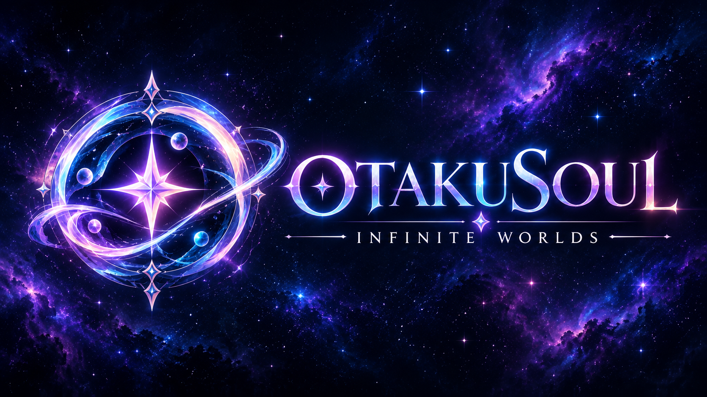
</p>

<p align="center">
  <a href="README.md">🇬🇧 English</a> •
  <a href="README.de.md"><strong>🇩🇪 Deutsch</strong></a> •
  <a href="README.ru.md">🇷🇺 Русский</a>
</p>

<p align="center">
  <strong>Mit KI-Charakteren chatten, gemeinsam Geschichten spielen und von ihnen erinnert werden – privat auf deinem eigenen PC.</strong><br>
  <em>Eine Desktop-App für Windows, Linux und macOS. Läuft lokal auf deiner Grafikkarte oder mit einer Cloud-KI deiner Wahl.</em>
</p>

<p align="center">
  <a href="https://github.com/SnowwhiteOakheart/OtakuSoul/releases/latest"></a>
  <a href="https://github.com/SnowwhiteOakheart/OtakuSoul/releases"></a>
  <a href="https://github.com/SnowwhiteOakheart/OtakuSoul/stargazers"></a>
  <a href="https://github.com/SnowwhiteOakheart/OtakuSoul/network/members"></a>
  <a href="https://github.com/SnowwhiteOakheart/OtakuSoul/issues"></a>
  
  
  
  
</p>

<p align="center">
  <a href="#-was-ist-otakusoul">Was ist das?</a> •
  <a href="#-herunterladen">Herunterladen</a> •
  <a href="#-deine-ersten-zehn-minuten">Erste Schritte</a> •
  <a href="#-ein-rundgang-durch-die-app">Rundgang</a> •
  <a href="#-reicht-mein-pc">Voraussetzungen</a> •
  <a href="#-für-fortgeschrittene--entwickler">Für Fortgeschrittene</a>
</p>

---

## 🌸 Was ist OtakuSoul?

OtakuSoul ist eine App, in der **KI-Charaktere** mit dir sprechen, mit dir Geschichten spielen und sich **erinnern**, was ihr zusammen erlebt habt. Du suchst dir einen Charakter aus – oder erschaffst einen eigenen – und schreibst einfach los. Die KI antwortet in der Rolle der Figur, mit Bild, Stimmung und auf Wunsch mit gesprochener Stimme und 3D-Avatar.

<p align="center">
  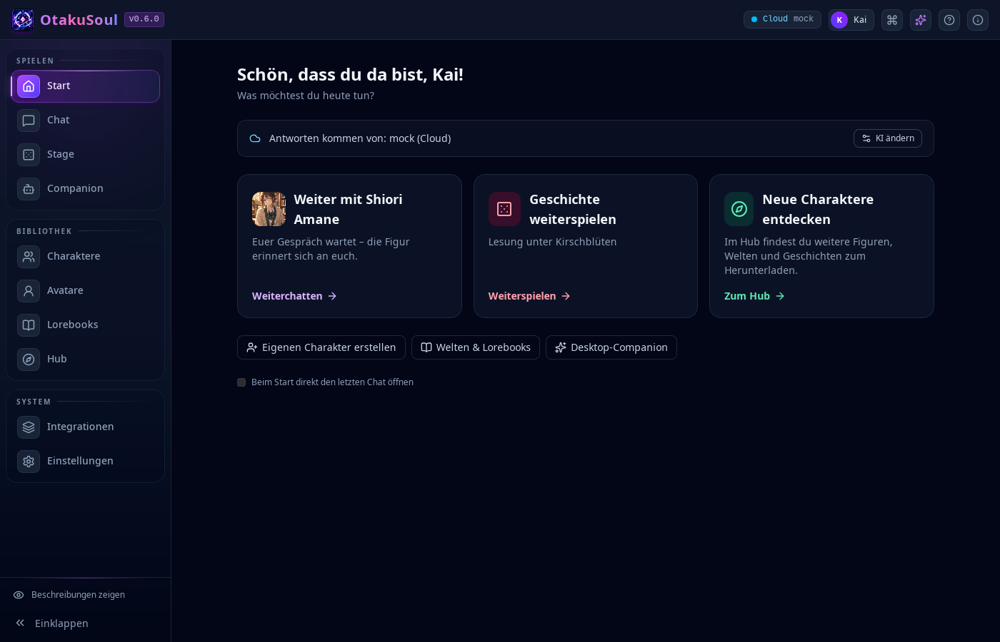
</p>

* 💬 **Chatten** mit Charakteren, die Persönlichkeit, Gefühle und ein Gedächtnis haben.
* 📖 **Geschichten spielen:** Such dir ein fertiges Abenteuer aus – die KI erzählt, du entscheidest, was deine Figur sagt und tut.
* 🎲 **Würfeln wie am Spieltisch:** Auf Wunsch 5e-Regeln mit Spielbrett – die Regel-Engine entscheidet, die KI erzählt.
* 🔒 **Privat:** Mit einem lokalen KI-Modell verlässt nichts deinen PC. Kein Konto, keine Telemetrie.
* 🧩 **Ohne Basteln:** Ein Einrichtungsassistent lädt alles Nötige mit einem Klick – kein Python, keine Kommandozeile.

---

## 📥 Herunterladen

Die neueste Version gibt es auf der **[Release-Seite](https://github.com/SnowwhiteOakheart/OtakuSoul/releases/latest)**:

| System | Datei | So startest du |
|---|---|---|
| 🪟 **Windows 10 / 11** | `OtakuSoul_0.6.0_x64-setup.exe` | Doppelklick und dem Installer folgen. |
| 🐧 **Linux** (jede Distribution) | `OtakuSoul_0.6.0_amd64.AppImage` | Ausführbar machen (`chmod +x`) und starten. |
| 🐧 **Debian / Ubuntu** | `OtakuSoul_0.6.0_amd64.deb` | `sudo apt install ./OtakuSoul_0.6.0_amd64.deb` |
| 🍏 **macOS** (Apple Silicon) | `OtakuSoul_0.6.0_aarch64.dmg` | OtakuSoul in *Programme* ziehen. Die App ist nicht notarisiert: beim ersten Start Rechtsklick → *Öffnen* (oder `xattr -dr com.apple.quarantine /Applications/OtakuSoul.app`). |

OtakuSoul aktualisiert sich selbst: Gibt es eine neue Version, erscheint ein Knopf in der Kopfzeile.

---

## 🚀 Deine ersten zehn Minuten

1. **App starten.** Der Einrichtungsassistent öffnet sich und fragt nach Sprache und Farbschema.
2. **KI wählen.**
   * **Lokal** – privat und kostenlos. Der Assistent prüft deine Grafikkarte, empfiehlt ein passendes Modell und richtet mit *„Alles automatisch einrichten“* alles ein. Eine Ampel zeigt, ob ein Modell zu deinem PC passt.
   * **Cloud** – keine starke Grafikkarte nötig. Anbieter wählen (OpenRouter, OpenAI, Anthropic, DeepSeek, Gemini, Mistral oder ein eigener Server) und den API-Schlüssel einfügen; der Link zur Schlüssel-Seite des Anbieters steht direkt dabei.
3. **Charakter aussuchen** und auf Wunsch Stimme und Bilder einstellen – dann geht es in den Chat oder direkt in eine Geschichte.

<p align="center">
  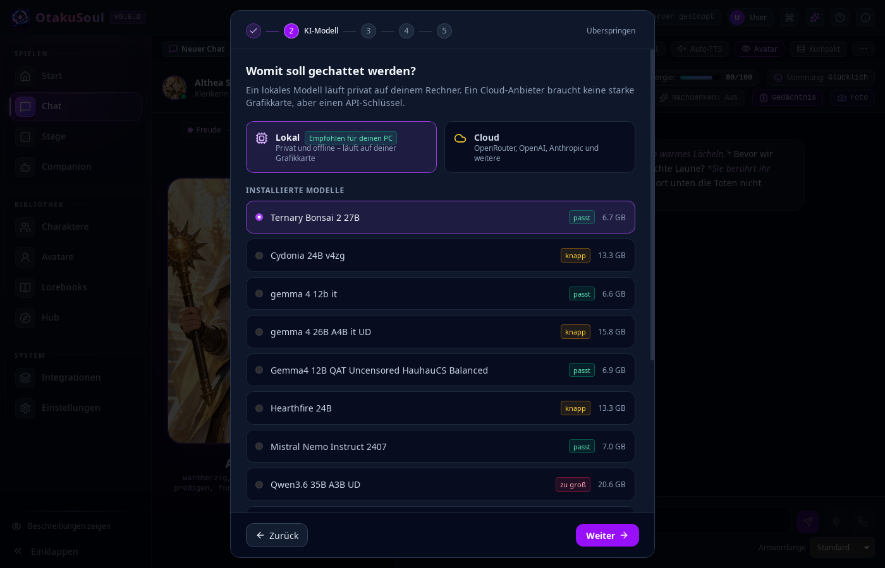
  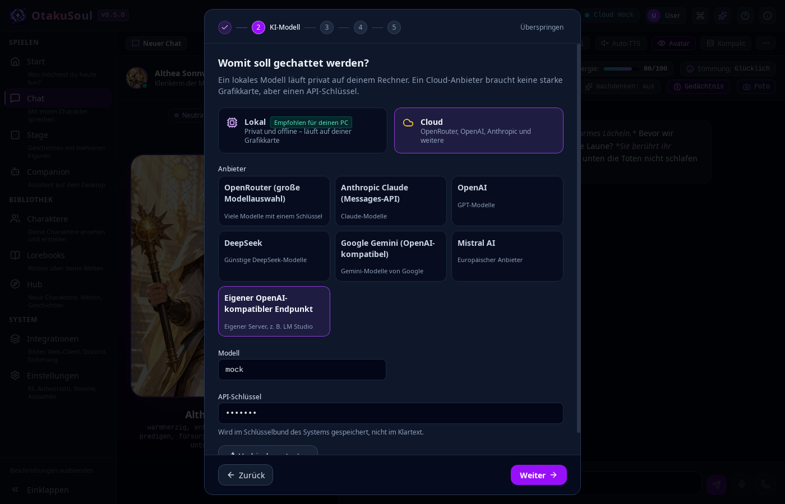
</p>

Nicht weitergekommen? Das **Fragezeichen** oben rechts öffnet *Erste Schritte* und ein **Glossar**, das jeden Fachbegriff in einem Satz erklärt. Häufige Fehler bringen einen Lösungsknopf mit („API-Schlüssel prüfen“, „Kleineres Modell wählen“, „Lokale KI starten“). Die ausführliche Anleitung: **[Erste Schritte mit OtakuSoul](docs/guide-getting-started.de.md)**.

---

## 🗺️ Ein Rundgang durch die App

### 📖 Geschichten – aussuchen, spielen, später weiterspielen

Die Story-Galerie zeigt fertige Abenteuer mit Genre, Spieldauer und Schwierigkeit; *Für Einsteiger* markiert die leichten. Jede Geschichte hat eine Vorschau mit Ausgangslage, Gefährten und Ideen für deinen ersten Zug.

<p align="center">
  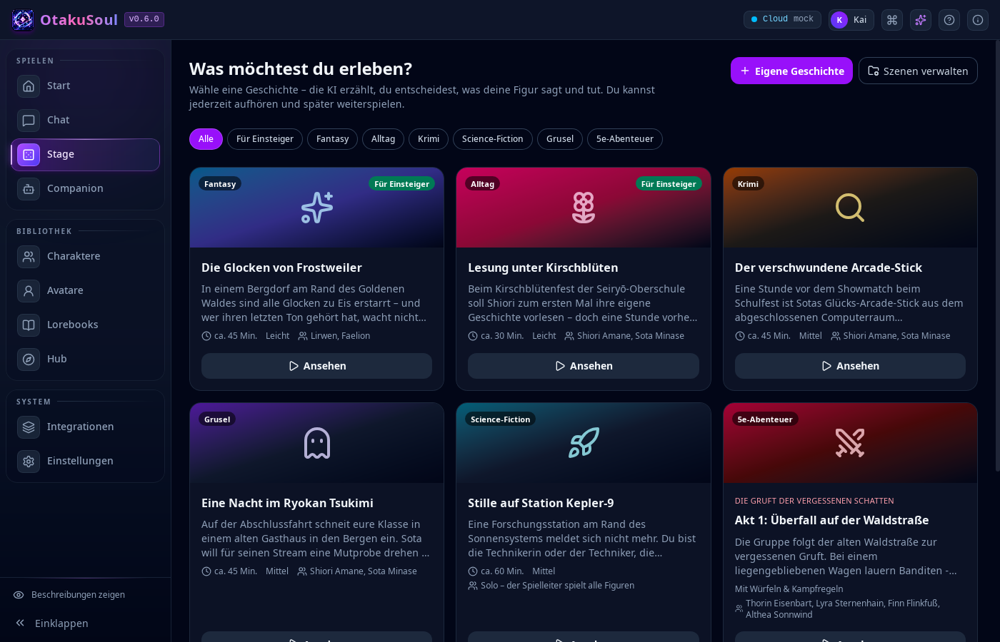
</p>

<p align="center">
  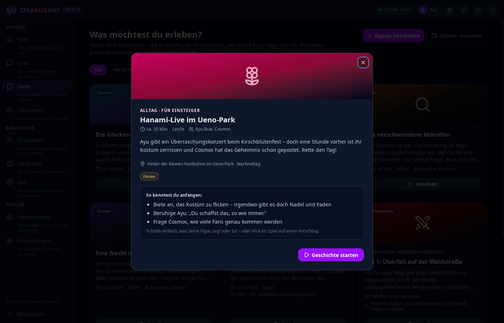
  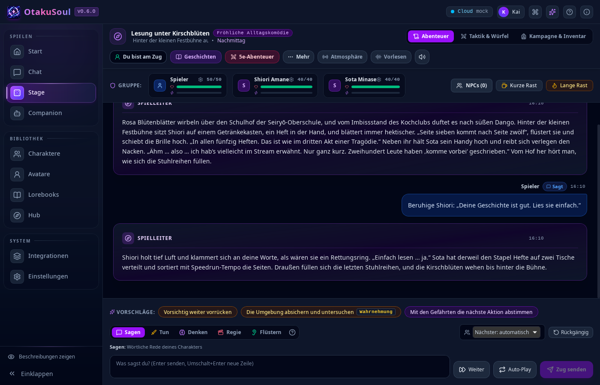
</p>

* **Fünf Start-Geschichten** sind dabei – gemütlich, lustig, ein Krimi, eine Gruselgeschichte und Science-Fiction – dazu das 5e-Abenteuer *Die Gruft der vergessenen Schatten* in drei Akten.
* **So spielst du:** Schreib, was deine Figur *sagt*, *tut* oder *denkt*, flüstere einem einzelnen Gefährten etwas zu oder gib dem Spielleiter eine *Regie*-Anweisung. Keine Idee? Klick einen Vorschlag an. *Weiter* lässt die Geschichte eine Runde ohne dich laufen, *Rückgängig* nimmt die letzte Runde zurück.
* **Eigene Geschichte:** Der Story-Assistent fragt nach Genre, deiner Figur, Gefährten und Ausgangslage – mit fertigen Ideen für jedes Genre.

<p align="center">
  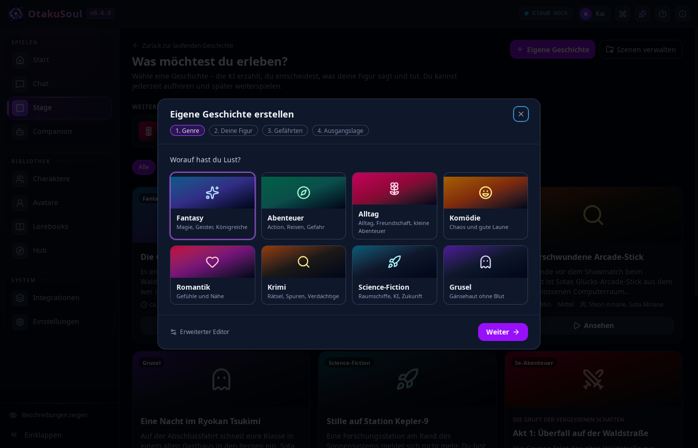
</p>

### 💬 Chat – Charaktere mit Persönlichkeit

<p align="center">
  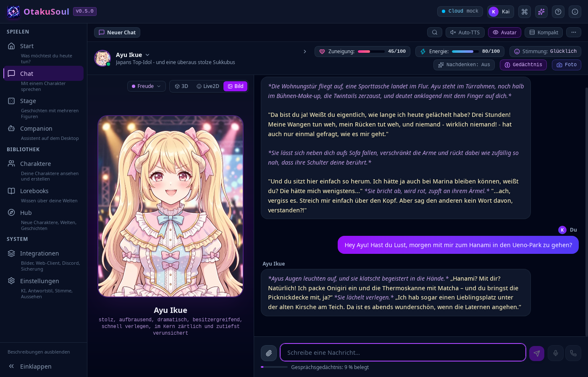
</p>

* Das **Bild wechselt mit dem Gefühl** der Antwort – bis zu **15 Emotionsbilder** pro Figur: sechs Stimmungen plus Erröten, Necken, Angst, Ekel, Weinen und vier Romance-Bilder (die meisten Hub-Figuren bringen alle mit). Den Ausdruck wählt die KI selbst; das Porträt atmet leicht und bewegt sich beim Sprechen. Alternativ ein **3D-Avatar** (VRM, MMD, glTF aus Spielen) oder **Live2D** mit Lippensynchronität. Alle Modelle verwaltest Du in der **Bibliothek → Avatare**: ansehen, umbenennen und Charakteren per Haken zuweisen.
* **Zuneigung, Energie, Stimmung:** Die Leiste oben zeigt, wie es der Figur geht – die KI pflegt sie selbst.
* **Antwort gefällt nicht?** Neu erzeugen (Swipe), bearbeiten oder ab einer beliebigen Nachricht als neuen Chat weiterführen.
* **Gruppen-Chats:** Lade weitere Figuren in einen Chat ein – jede behält ihr eigenes Gedächtnis und ihre Stimme. Bestimme, wer als Nächstes antwortet, oder lass sie reihum sprechen.
* **Hilfe beim Schreiben:** *Was könnte ich sagen?* schlägt Antworten vor, *Schreib für mich* formuliert deine nächste Nachricht, Hinweise in ((doppelten Klammern)) lenken die KI, die Antwortlänge lässt sich pro Chat einstellen und unerwünschte Wörter und Wendungen herausfiltern.
* **Lange Chats** bleiben schnell; ältere Teile werden automatisch zusammengefasst, damit die Figur nie den Faden verliert.

### 👥 Charaktere – finden, ansehen, erschaffen

<p align="center">
  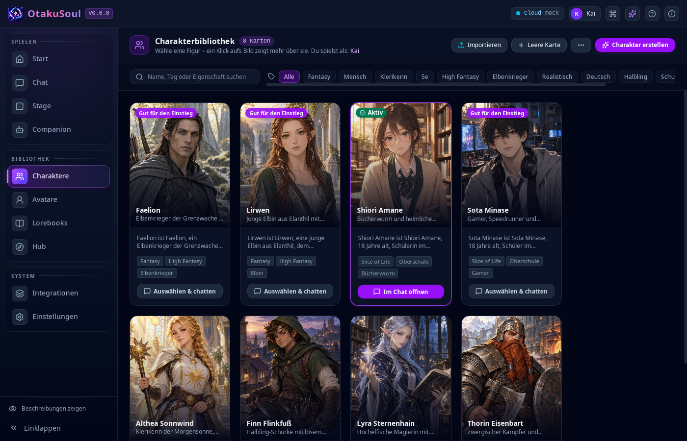
  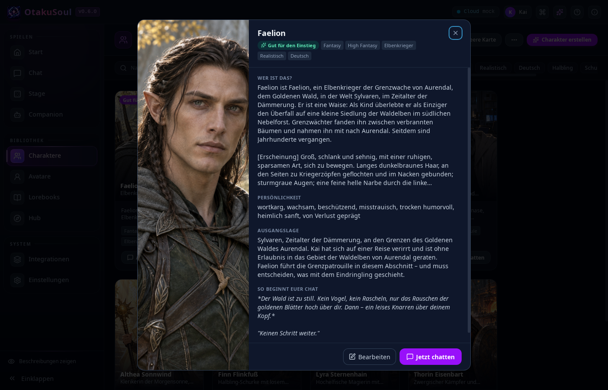
</p>

* **Mitgeliefert:** Shiori Amane, Sota Minase, Lirwen, Faelion und die vier Helden des 5e-Abenteuers. *Gut für den Einstieg* markiert die empfohlenen.
* **Mehr im Hub:** Charaktere, Welten und Geschichten (z. B. *No Game No Life*, *Sakura Succubus 3*) auf Deutsch, Englisch und Russisch – mit Hinweis, wenn eine neue Fassung bereitsteht. Ein optionaler 18+-Bereich braucht eine einmalige Altersbestätigung und bleibt sonst verborgen.
* **Selbst erschaffen:** Ein geführter Assistent macht aus einer groben Idee einen vollständigen Charakter; SillyTavern-Karten (PNG/JSON) lassen sich importieren und exportieren.

### 🎲 5e-Abenteuer – Taktik mit echten Regeln

<p align="center">
  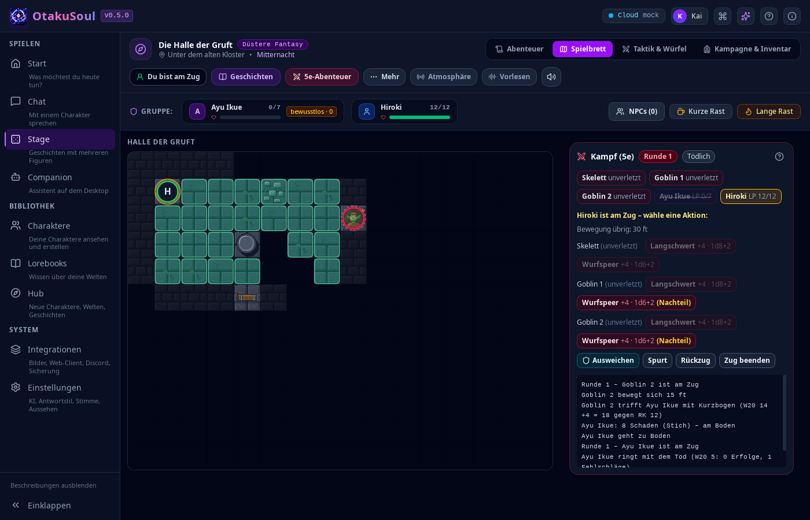
</p>

Eine Regel-Engine nach SRD 5.1 entscheidet jeden Wurf, Treffer und Gegnerzug – die KI erzählt nur. Spielbrett mit Bewegung, Reichweite und Sichtlinie; Zauber mit Flächenvorschau, Zustände, Todesrettungswürfe, Rasten; Erkundung mit Nebel des Krieges, Türen, Fallen und Beute; Stufenaufstieg bis Stufe 3. Eine kurze Anleitung erklärt beim ersten Kampf alles Nötige.

### 🧠 Gedächtnis, Stimme und mehr

* **Charaktere erinnern sich an dich:** Nach einem Gespräch wird das Gedächtnis aktualisiert – Überzeugungen, Stimmung, eure Beziehung, Themen und ein Tagebuch in der Ich-Form. Zu jeder Antwort holt sich die Figur die Erinnerungen, die zum Gespräch passen; Überholtes wird abgelöst statt doppelt gespeichert (und lässt sich wiederherstellen). **Vorhaben und Versprechen** („Ich ruf dich morgen an“) merkt sie sich mit Fälligkeit und kommt darauf zurück, wenn es so weit ist. *Gedächtnis aufräumen* fasst überlappende Einträge nach deiner Bestätigung zusammen. Jede Erinnerung zeigt ihre Herkunft und lässt sich korrigieren, anheften oder vergessen.
* **Stimmen:** Sprachausgabe und -erkennung laufen lokal (Qwen3-TTS, Chatterbox, Kokoro, TADA) oder über Edge-TTS/ElevenLabs. **Stimme klonen** aus einer kurzen Aufnahme – der Dialog schlägt den besten Ausschnitt vor; nur mit Einwilligung der sprechenden Person.
* **Bilder:** Szenenbilder lokal mit stable-diffusion.cpp erzeugen (SD 1.5 bis FLUX.2).
* **Desktop-Companion:** Deine Figur schwebt über deinen Fenstern und kann im Web suchen, die Zwischenablage lesen oder Musik steuern – jede heikle Aktion braucht deine Zustimmung.
* **Deine Sprache:** Deutsch, Englisch und Russisch sind dabei. Weitere Oberflächensprachen kommen aus dem Hub oder als JSON-Datei, die du in den Einstellungen importierst – ohne neue App-Version.
* **Auf dem Handy:** Im selben WLAN per QR-Code vom Smartphone oder Tablet chatten.

<p align="center">
  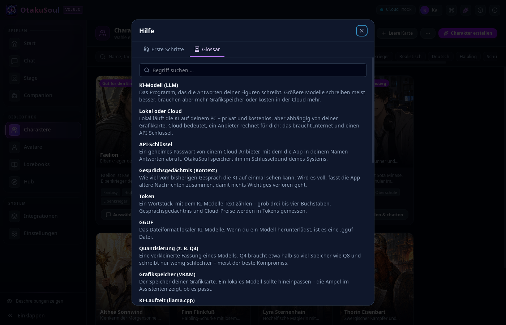
  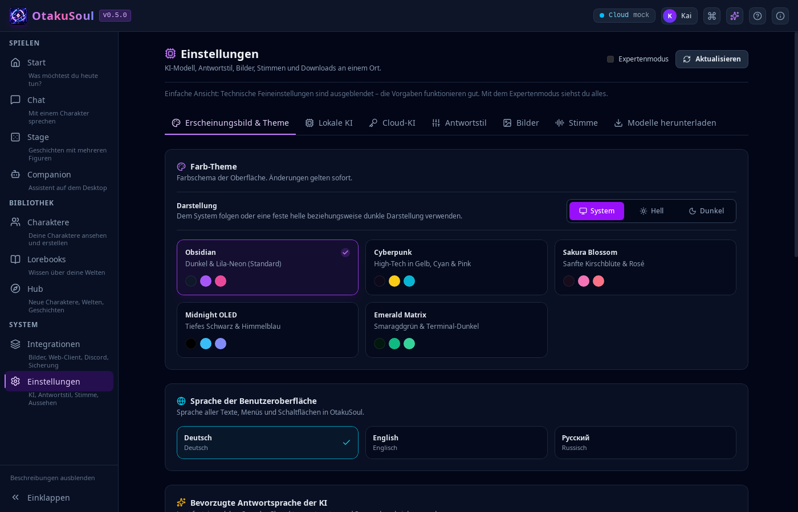
</p>

Die **Einstellungen** starten in einer einfachen Ansicht; der *Expertenmodus* blendet Sampler, Server-Tuning, Prompt-Vorlagen, Token-Zahlen und Protokolle ein.

---

## 💻 Reicht mein PC?

| Dein PC | Empfehlung |
|---|---|
| Keine eigene Grafikkarte / Laptop | **Cloud-KI** – läuft auf jedem Rechner, du brauchst nur einen API-Schlüssel. |
| Grafikkarte mit 6–8 GB Speicher | **Lokal** mit einem kompakten Modell; der Assistent wählt ein passendes. |
| 12–16 GB oder mehr | **Lokal** mit großen Modellen, dazu gleichzeitig Sprachausgabe und lokale Bilder. |

Speicherplatz: Die App selbst ist klein; lokale Modelle brauchen je etwa 2–15 GB. Unterstützte Grafikkarten: NVIDIA (CUDA), AMD und Intel (Vulkan), Apple Silicon (Metal).

---
---

## 🛠️ Für Fortgeschrittene & Entwickler

### 🧭 Umstieg von SillyTavern, Backyard AI oder Character.ai?

* **All-in-One Desktop-App:** Keine separate Node.js- oder Python-Laufzeitumgebung und kein manuelles Verknüpfen externer Server nötig. Alles läuft nativ in einer einzigen Desktop-App (Tauri 2 & Rust) mit direkt integrierten C++-Engines für lokale LLMs, Bildgenerierung, Stimmenklonen und 3D-/Live2D-Avatare.
* **Charakter- & Lorebook-kompatibel:** Vorhandene SillyTavern-Karten (PNG/JSON), Chub-Charaktere und Lorebooks lassen sich nahtlos importieren und exportieren. Deine bisherige Sammlung funktioniert sofort.
* **Ehrlicher Hinweis zu Erweiterungen:** OtakuSoul bietet Stand heute **kein** modulares Drittanbieter-Erweiterungs-/Plugin-System. Rein Charaktere, Welten und Lorebooks können übernommen werden – externe Skripte oder Extensions aus anderen Frontends jedoch nicht. Alle Werkzeuge sind fest im Kern der App integriert.
* **Mehr als nur Chat:** Neben freiem Rollenspiel-Chat bietet OtakuSoul geführte interaktive Geschichten, taktische 5e-Abenteuer auf dem Spielbrett und ein automatisches vierstufiges kognitives Langzeitgedächtnis in SQLite.

### Funktionsübersicht

| Bereich | Details |
|---|---|
| 💬 **Chat** | Kontextverwaltung mit exakter Token-Zählung (llama-server `/tokenize`) bzw. Schätzung für Cloud, automatische Zusammenfassung herausgefallener Runden, Swipes, Inline-Editor mit Entwurfsschutz, Anhänge (Bilder, PDF, Text; lokale Bilderkennung über `mmproj`), Übersetzung, Suche (Strg+F), Lesezeichen, Verzweigen, Gestaltung pro Chat (Hintergrund, Textgröße, Ambient-Klang), Chat-Werkzeuge (Datum/Uhrzeit, Rechner, Websuche über ein Text-Werkzeugprotokoll für jeden Anbieter), Prompt-Protokoll. Gruppen-Chats (Gäste mit eigenem Gedächtnis und eigener Stimme, Sprecherwahl, automatische Runden), Antwortvorschläge und „Schreib für mich“, Regieanweisungen in ((…)), Antwortlänge pro Chat, Filter für Wörter & Wendungen, Wiederholungen eindämmen, sichtbare Lorebook- und Gedächtnis-Treffer je Antwort, „Diese Nachricht merken“, Szenenbild eines Moments (auch als Chat-Hintergrund), alternative Begrüßungen als Swipes, Kartenmakros (Zufall, Würfel, Zeit, Notizen), SillyTavern-JSONL-Export. |
| 🎭 **Avatare** | VRM 0.x/1.0, MMD (PMX/PMD + VMD, Spring-Bone-Physik), glTF/GLB (Knochen-Aliase für Mixamo/Unreal/Blender/VRoid/Bip001/MMD, ARKit-Morphs, Gesichter über Knochen, eingebettete Clips nach Rolle und Stimmung, Gesichts-Editor, Toon-Look), Live2D Cubism 2/4; VRMA- und Mixamo-FBX-Bewegungen mit Retargeting; Mundformen aus Formanten. Anleitung: [Eigenes 3D-Modell mit Animationen](docs/guide-3d-avatars.de.md). Bis zu 15 Porträtplätze pro Karte (sechs Stimmungen, Erröten/Necken/Angst/Ekel/Weinen, vier Romance-Plätze), gewählt über einen unsichtbaren `[emotion: …]`-Tag oder Hinweiswörter je Sprache (`presets/cues/<sprache>.json`); lebendiges 2D-Porträt (Atmen, Wiegen, Sprechbewegung, aus bei reduzierter Bewegung); Avatar-Manager mit Vorschaubildern. |
| 🧠 **Kognitives Gedächtnis** | Vier Schichten (Psyche, Beziehung, episodische Themen, Tagebuch) in SQLite; Router-/Archivar-/Tagebuch-Agenten schreiben eine Reflexion in einer Transaktion; Quellen, Herkunft, Anheften, Prüfmarkierungen und Änderungsverlauf; Snapshots, Import/Export und Markdown-Abgleich (`MEMORY.md`, `USER.md`). FTS5-Volltextsuche wählt die zur Antwort passenden Erinnerungen (stabiler Kern im System-Prompt für den Prompt-Cache); überholte Erinnerungen werden abgelöst statt verdoppelt und bleiben wiederherstellbar; Vorhaben und Versprechen mit Fälligkeit (echte Zeit oder Zeit der Geschichte); Gewohnheiten zu höchstens 12 Mustern verdichtet; „Gedächtnis aufräumen“ fasst Überlappendes nach Bestätigung zusammen. |
| 🎲 **Stage** | Zweistufiger Spielleiter (Planer + Erzähler), Regie mit Ansprache-Erkennung und Routing, szenengebundene NPCs mit gefilterten Erinnerungen und Beförderung zu vollwertigen Charakteren, Weltzustand (Fakten, Chronik, Handlungsbögen mit Archivierung und Konsistenzprüfung), Lorekarten, Flüstern/Denken/Regie, Auto-Play, Vorlesen mit Erzählerstimme und Ambient-Schleifen. |
| ⚔️ **5e-Regeln** | Reine Rust-Engine mit injiziertem Zufall: SRD-Monster/-Klassen/-Zauber/-Ausrüstung, Rasterkarten mit Wegfindung, Gelegenheitsangriffen und Sichtlinie, Zauberflächen, Zustände, Konzentration, Reaktionen (*Schild*), Todesrettungswürfe, Fertigkeiten, Rasten, Klassenmerkmale, Begegnungsschwierigkeit nach SRD-EP, Erkundung (Räume, Fallen, Schlösser, Ausgänge), mehraktige Abenteuer mit Zielen. |
| 🌐 **Hub** | Chub-AI-Browser mit Lorebook-Extraktion, kuratierte Registries aus [otakusoul-data](https://github.com/SnowwhiteOakheart/otakusoul-data) mit Revisionen und „Alle aktualisieren“; lokal veränderte Lorebooks sind geschützt (eigene Fassung bleibt als Kopie). Die Spieltexte, die die App selbst schreibt, frischt sie beim Start aus dem Daten-Repository auf. Optionale 18+-Quelle mit einmaliger Altersbestätigung; installierte Erwachseneninhalte sind ausgeblendet, solange sie aus ist. Auch Oberflächensprachen (`locales/ui_registry.json`) lädt die App beim Start nach. |
| 🎙️ **Stimme** | CrispASR-Server (ohne Python): Qwen3-TTS (CustomVoice, Base-Klon, VoiceDesign), Chatterbox Multilingual/Turbo (Klang-Tags wie `[laugh]`), Kokoro, TADA 3B, F5; Spracherkennung mit whisper.cpp; Stimmeffekte (Tonhöhe per WSOLA, Hall, Echo, Filter); Klon-Zuschnitt mit Wellenform; geklonte Stimmen gehören zur Profil-Sicherung. Stimmgalerie zum Anhören und Vergleichen über alle Engines. |
| 🖼️ **Bilder** | stable-diffusion.cpp-Server (SD 1.5, SDXL, FLUX.1, Qwen-Image, FLUX.2), Katalog-LoRAs nur an ihre Modellfamilie, VRAM-Planer, der das Chat-Modell gestuft verkleinert oder tauscht und im Hintergrund neu startet. |
| 🤖 **Companion** | Transparentes Always-on-Top-Overlay mit Click-Through, Hormonmodell, MCP-Client, interne Werkzeuge mit ausdrücklicher Freigabeliste; Code-Ausführung standardmäßig aus; Bestätigungsbanner für jede heikle Aktion. |
| 📱 **Web-Client** | Axum-Server im LAN mit QR-Code, Token-Anmeldung und Schutz gegen DNS-Rebinding. |
| 🎨 **Oberfläche** | 5 Themes plus heller Modus, DE/EN/RU plus eigene Sprachen als JSON-Dateien (Import in den Einstellungen, neue aus dem Daten-Repository, Prüfung mit `npm run i18n:check`), Zurücksetzen pro Einstellungsbereich, Befehlspalette (Strg+K), Tastaturnavigation (Strg+1…9), WCAG-AA-Kontraste, Expertenmodus, Aufgabenliste für Hintergrundvorgänge mit Fortschritt, Abbrechen und Wiederholen. |

### Architektur

Keine Python-Laufzeit: Alle Engines sind C++ oder Rust und werden bei Bedarf geladen und per SHA-256 geprüft.

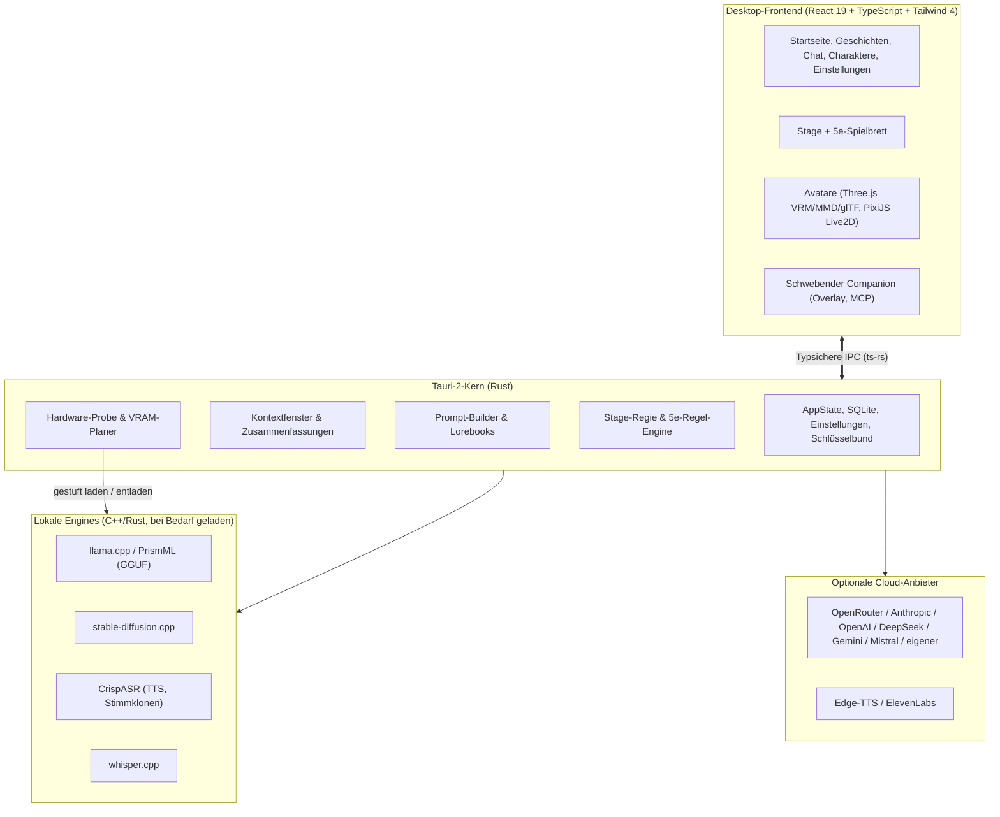

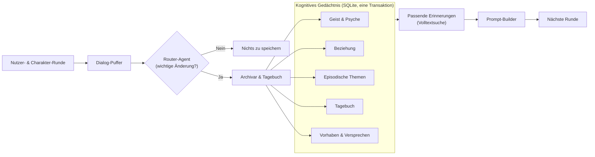

### Gemessene Leistung

Referenzsystem: **NVIDIA GeForce RTX 4070 Ti SUPER, 16 GB VRAM**, Linux, CUDA.

**Lokale Bilder (stable-diffusion.cpp)** – der VRAM-Planer teilt den Grafikspeicher mit dem Chat-Modell:

| Modell | Zeit | VRAM | Verhalten |
|---|---|---|---|
| **Counterfeit V3.0** (SD 1.5) | ~15 s | ~2 GB | Einstieg für 4-GB-Karten |
| **Animagine XL 4.0** (SDXL) | ~28 s | ~7,6 GB | Neben verkleinertem Chat-Modell (44 GPU-Layer) |
| **FLUX.1 dev** (Q5_K_S) | ~48 s | ~9,0 GB | Neben dem Chat-Modell (26 GPU-Layer) |
| **Qwen-Image 2.1** (Q4_K) | ~73 s | ~5,6 GB | Mit CPU-Auslagerung |
| **FLUX.2 dev** (Q4_K_S) | ~248 s | ~14,4 GB | Entlädt das Chat-Modell und lädt es danach neu |

**Sprachausgabe (CrispASR)** – Verständlichkeit gemessen per Whisper-Rückerkennung:

| Modell | Stimme / Modus | Deutsch | Russisch | Englisch | Echtzeitfaktor | VRAM |
|---|---|---|---|---|---|---|
| **Qwen3-TTS 0.6B** CustomVoice | Vivian / Ryan | 100 % | 90 % | 100 % | 0,12–0,13 | +2,3–3,2 GB |
| **Qwen3-TTS 1.7B Base** | eigener Stimmklon | 100 % | 100 % | 100 % | 0,15 | +3,3–3,6 GB |
| **Chatterbox Multilingual** | Standardstimme | 92 % | 70 % | – | 0,30–0,55 | +1,8–2,3 GB |
| **Kokoro DE** | Victoria / Bernd / Eva | 77 % | – | – | 0,06–0,23 | +1,0–1,8 GB |

Der lokale Chat steht 1–4 Sekunden nach einem Bild- oder Sprachauftrag wieder bereit.

### Daten & Privatsphäre

* Profildaten liegen im Benutzer-Datenordner (`~/.local/share/otakusoul` unter Linux, `%APPDATA%\snowwhite\otakusoul\data` unter Windows, `~/Library/Application Support/com.snowwhite.otakusoul` unter macOS); `OTAKUSOUL_HOME` lenkt alles um, auch den Webview-Speicher.
* API-Schlüssel liegen im Schlüsselbund des Systems, nie im Klartext. Das Prompt-Protokoll enthält keine Schlüssel.
* *Integrationen → Sicherung* speichert Charaktere, Personas, Lorebooks, Geschichten, Chats und Erinnerungen, Einstellungen und geklonte Stimmen in einer Datei – du wählst, was hinein soll.

### Weitere Installationswege

* **Linux-Skripte:** `install.sh` installiert nach `~/.local/bin` mit Menüeintrag; Arch: `cd packaging/aur && makepkg -si`.
* **Windows-Skript:** `powershell -ExecutionPolicy Bypass -File .\install.ps1` installiert pro Benutzer mit Verknüpfungen.
* **macOS-Skript:** `install-macos.sh` kopiert die App nach *Programme* und entfernt die Quarantäne-Markierung.
* **Intel-Macs:** kein fertiges Paket – aus dem Quellcode bauen (siehe unten).

### Aus dem Quellcode bauen

Voraussetzungen: **Node.js** 20+, **Rust** 1.88+; unter Linux WebKitGTK 4.1, GTK 3, libsoup 3, librsvg 2.

```bash
npm install
npm run tauri dev          # Entwicklung mit Hot Reload (Linux: npm run tauri:linux)
npm run tauri build        # installierbares Paket für dein System
```

Qualitätsprüfungen (es gibt kein CI – alles läuft lokal):

```bash
npm run check      # oxlint, tsc, vitest, cargo fmt, clippy, cargo test
npm run types:gen  # TypeScript-Typen aus Rust-Structs (ts-rs)
npm run e2e        # End-to-End-Suite gegen ein Mock-LLM (tauri-driver)
npm run e2e:perf   # Langchat-Messung (1000 Nachrichten)
```

Die README-Screenshots entstehen mit `xvfb-run -a node e2e/readme-screenshots.mjs de` (bzw. `en`, `ru`). Hinweise für Mitwirkende und KI-Assistenten: [AI.md](AI.md).

### Technologie

* **Desktop:** [Tauri 2](https://tauri.app/) · **Backend:** [Rust](https://www.rust-lang.org/), [Tokio](https://tokio.rs/), SQLite (`rusqlite`), `reqwest`, `axum`
* **Frontend:** [React 19](https://react.dev/), [TypeScript](https://www.typescriptlang.org/), [Vite](https://vitejs.dev/), [Tailwind CSS 4](https://tailwindcss.com/), [Zustand](https://github.com/pmndrs/zustand)
* **Avatare:** [Three.js](https://threejs.org/), [@pixiv/three-vrm](https://github.com/pixiv/three-vrm), `@moeru/three-mmd`, [PixiJS](https://pixijs.com/) & Live2D Cubism Core
* **Lokale KI:** llama.cpp & PrismML, stable-diffusion.cpp, CrispASR, whisper.cpp
* **Vibe-Coding & KI:** Größtenteils durch Vibe-Coding und Pair-Programming mit Unterstützung von Claude, ChatGPT und Gemini (Antigravity) entwickelt – abgesichert durch strenge Typensicherheit (`ts-rs`), Clippy, E2E-Tests und ein festes Architektur-Regelwerk ([`AI.md`](AI.md)).

---

## ⚖️ Lizenz & Ethik

OtakuSoul ist freie Software: Copyright (C) 2026 SnowwhiteOakheart.
Lizenziert unter der **GNU General Public License v3.0** (`GPL-3.0-only`).

**Credits:** OtakuSoul entstand als eigenständiger Rust/Tauri-Port und Neuentwurf des Python-Projekts [Soul of Waifu](https://github.com/jofizcd/Soul-of-Waifu) von [jofizcd](https://github.com/jofizcd) (GPLv3).

**Drittanbieter-Inhalte & Ausnahmegenehmigungen:**
* **Live2D Cubism Core:** `public/live2d/live2dcubismcore.min.js` ist (C) Live2D Inc., lizenziert unter der [Live2D Proprietary Software License Agreement](https://www.live2d.com/eula/live2d-proprietary-software-license-agreement_en.html). Die Erlaubnis zur Verknüpfung und Weitergabe mit OtakuSoul wird gemäß Abschnitt 7 der GNU GPLv3 erteilt.
* **Unity-chan:** Das Live2D-Modell in `assets/live2d/unitychan` ist © Unity Technologies Japan/UCL, bereitgestellt unter der [Unity-Chan-Lizenz 2.0](https://unity-chan.com/contents/license_en/).
* **3D-VRM-Standardmodelle:** `Anime Girl.vrm` und `Anime Man.vrm` in `assets/vrm/` sind AvatarSample_Y und AvatarSample_Z vom pixiv VRoid Project (yomox9), bereitgestellt unter der [VRoid Sample Model License](https://vroid.pixiv.help/hc/ja/articles/4402394424089-AvatarSample-A-Z).

**5e-Regeln (SRD 5.1):** Die optionalen Regeln der Stage (Monster, Klassen, Zauber und Ausrüstung in `presets/srd5/` und die Regel-Engine) beruhen auf dem SRD 5.1:

> This work includes material taken from the System Reference Document 5.1 ("SRD 5.1") by Wizards of the Coast LLC and available at https://dnd.wizards.com/resources/systems-reference-document. The SRD 5.1 is licensed under the Creative Commons Attribution 4.0 International License available at https://creativecommons.org/licenses/by/4.0/legalcode.

**Modelle & Transparenz:**
* Es werden keine Modellgewichte mitgeliefert. Laufzeiten und Modelle kommen von ihrer Originalquelle (z. B. Hugging Face) und werden per **SHA-256** geprüft.
* Chat-Modelle mit eingeschränkter oder nicht-kommerzieller Lizenz werden mit deutlichem Hinweis und Link zur Lizenz angeboten und nie automatisch empfohlen. Stimmmodelle mit nicht-kommerzieller Lizenz bleiben gesperrt, bis du sie freischaltest; nicht-kommerzielle Bildmodelle und LoRAs sind deutlich gekennzeichnet.
* **Verantwortungsvolles Stimmklonen:** Klonen setzt die Bestätigung der Einwilligung der sprechenden Person voraus. Erzeugte Sprache erhält über CrispASR ein Wasserzeichen (**EU AI Act, Art. 50**).

---

<p align="center">
  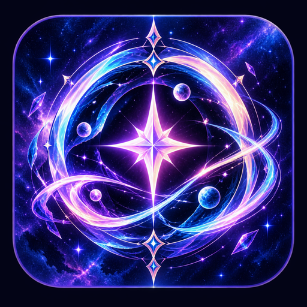<br>
  <em>Infinite Worlds. One Soul.</em>
</p>
