<p align="center">
  
</p>

<p align="center">
  <a href="README.md"><strong>🇬🇧 English</strong></a> •
  <a href="README.de.md">🇩🇪 Deutsch</a> •
  <a href="README.ru.md">🇷🇺 Русский</a>
</p>

<p align="center">
  <strong>Chat with AI characters, play stories together and let them remember you – privately on your own PC.</strong><br>
  <em>A desktop app for Windows, Linux and macOS. Runs locally on your graphics card or with a cloud AI of your choice.</em>
</p>

<p align="center">
  <a href="https://github.com/SnowwhiteOakheart/OtakuSoul/releases/latest"></a>
  <a href="https://github.com/SnowwhiteOakheart/OtakuSoul/releases"></a>
  <a href="https://github.com/SnowwhiteOakheart/OtakuSoul/stargazers"></a>
  <a href="https://github.com/SnowwhiteOakheart/OtakuSoul/network/members"></a>
  <a href="https://github.com/SnowwhiteOakheart/OtakuSoul/issues"></a>
  
  
  
  
</p>

<p align="center">
  <a href="#-what-is-otakusoul">What is it?</a> •
  <a href="#-download">Download</a> •
  <a href="#-your-first-ten-minutes">First steps</a> •
  <a href="#-a-tour-through-the-app">Tour</a> •
  <a href="#-is-my-pc-good-enough">Requirements</a> •
  <a href="#-for-power-users--developers">For power users</a>
</p>

---

## 🌸 What is OtakuSoul?

OtakuSoul is an app in which **AI characters** talk to you, play stories with you and **remember** what you experienced together. You pick a character – or create your own – and simply write. The AI answers in the character's voice, with picture, mood and, if you like, spoken voice and a 3D avatar.

<p align="center">
  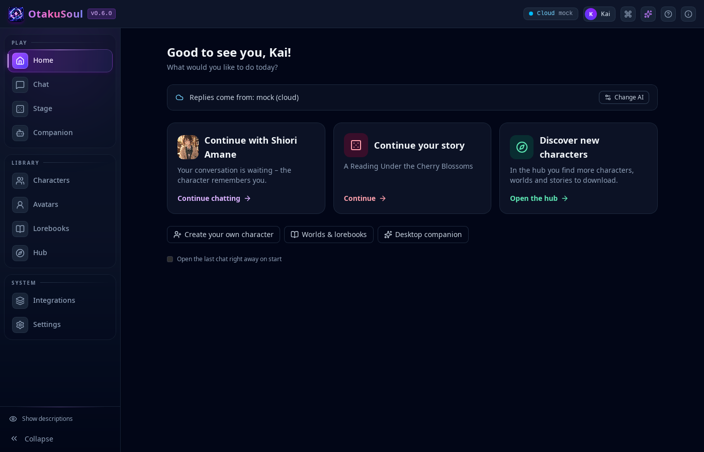
</p>

* 💬 **Chat** with characters that have a personality, feelings and a memory.
* 📖 **Play stories:** pick a ready-made adventure, the AI narrates, you decide what your character says and does.
* 🎲 **Roll dice like at the table:** optional 5e rules with a battle map – the rules engine decides, the AI tells the story.
* 🔒 **Private:** with a local AI model nothing leaves your PC. No account, no telemetry.
* 🧩 **No tinkering:** a setup assistant downloads everything needed with one click – no Python, no command line.

---

## 📥 Download

Get the latest version from the **[Releases page](https://github.com/SnowwhiteOakheart/OtakuSoul/releases/latest)**:

| System | File | How to start |
|---|---|---|
| 🪟 **Windows 10 / 11** | `OtakuSoul_0.6.0_x64-setup.exe` | Double-click and follow the installer. |
| 🐧 **Linux** (any distribution) | `OtakuSoul_0.6.0_amd64.AppImage` | Make it executable (`chmod +x`) and start it. |
| 🐧 **Debian / Ubuntu** | `OtakuSoul_0.6.0_amd64.deb` | `sudo apt install ./OtakuSoul_0.6.0_amd64.deb` |
| 🍏 **macOS** (Apple Silicon) | `OtakuSoul_0.6.0_aarch64.dmg` | Drag OtakuSoul into *Applications*. The app is not notarised: on first start right-click → *Open* (or run `xattr -dr com.apple.quarantine /Applications/OtakuSoul.app`). |

OtakuSoul updates itself: when a new version is out, a button appears in the title bar.

---

## 🚀 Your first ten minutes

1. **Start the app.** The setup assistant opens and asks for your language and colour theme.
2. **Choose the AI.**
   * **Local** – private and free. The assistant checks your graphics card, recommends a matching model and sets everything up with *“Set everything up automatically”*. A traffic light shows whether a model fits your PC.
   * **Cloud** – no strong graphics card needed. Pick a provider (OpenRouter, OpenAI, Anthropic, DeepSeek, Gemini, Mistral or your own server) and paste your API key; the link to the provider's key page is right there.
3. **Pick a character** and, if you like, a voice and pictures – then off you go into a chat or straight into a story.

<p align="center">
  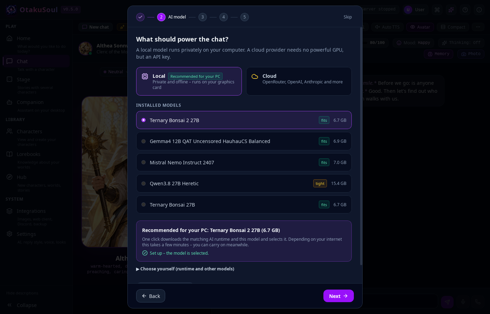
  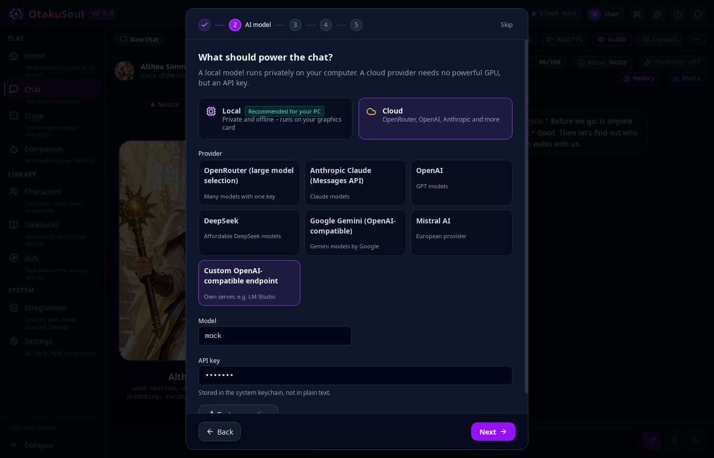
</p>

Stuck? The **question mark** at the top right opens *First steps* and a **glossary** that explains every technical term in one sentence. Common errors come with a fix button (“Check API key”, “Choose a smaller model”, “Start local AI”). The full guide: **[Getting started with OtakuSoul](docs/guide-getting-started.md)**.

---

## 🗺️ A tour through the app

### 📖 Stories – choose, play, carry on later

The story gallery shows ready-made adventures with genre, playing time and difficulty; *For beginners* marks the easy ones. Each story has a preview with its situation, companions and ideas for your first move.

<p align="center">
  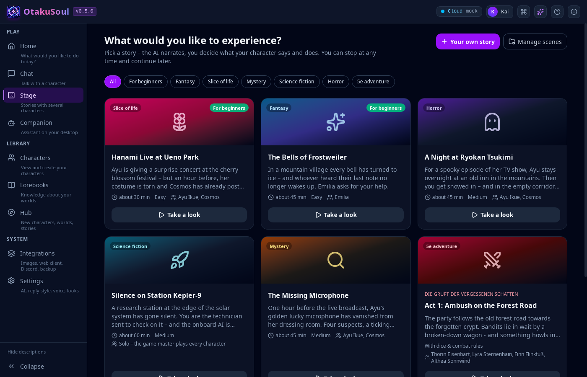
</p>

<p align="center">
  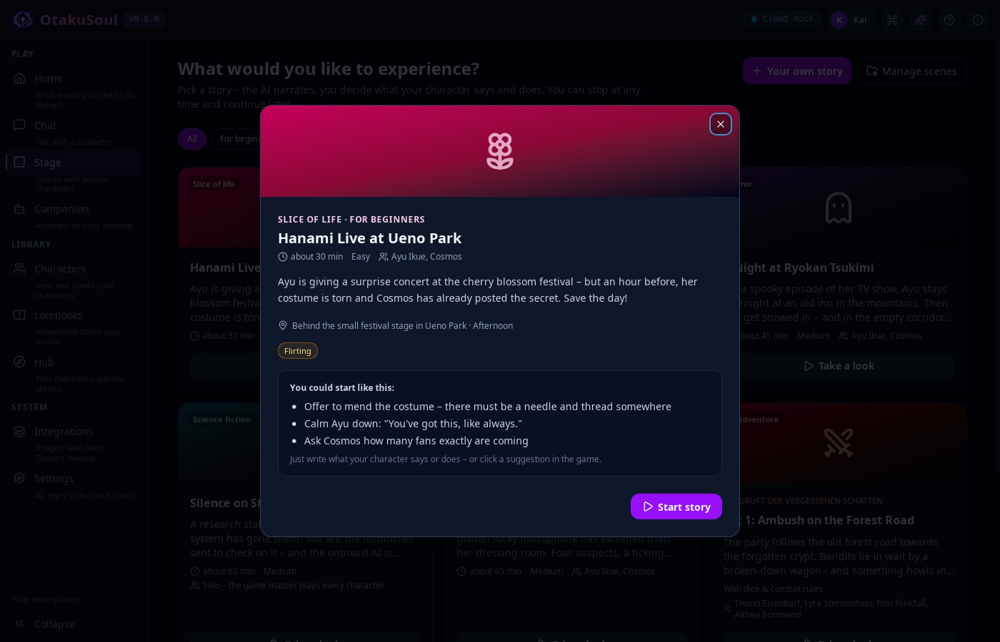
  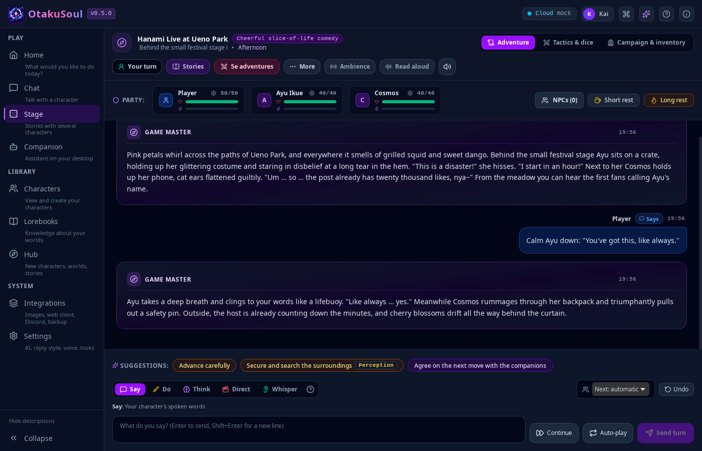
</p>

* **Five starter stories** ship with the app – cosy, funny, a mystery, a ghost story and science fiction – plus the three-act 5e adventure *The Crypt of Forgotten Shadows*.
* **How to play:** write what your character *says*, *does* or *thinks*, whisper to a single companion or give the game master a stage *direction*. No idea? Click one of the suggestions. *Continue* lets the story run a round without you, *Undo* takes back the last round.
* **Your own story:** the story wizard asks for genre, your character, companions and the starting situation – with ready-made ideas for every genre.

<p align="center">
  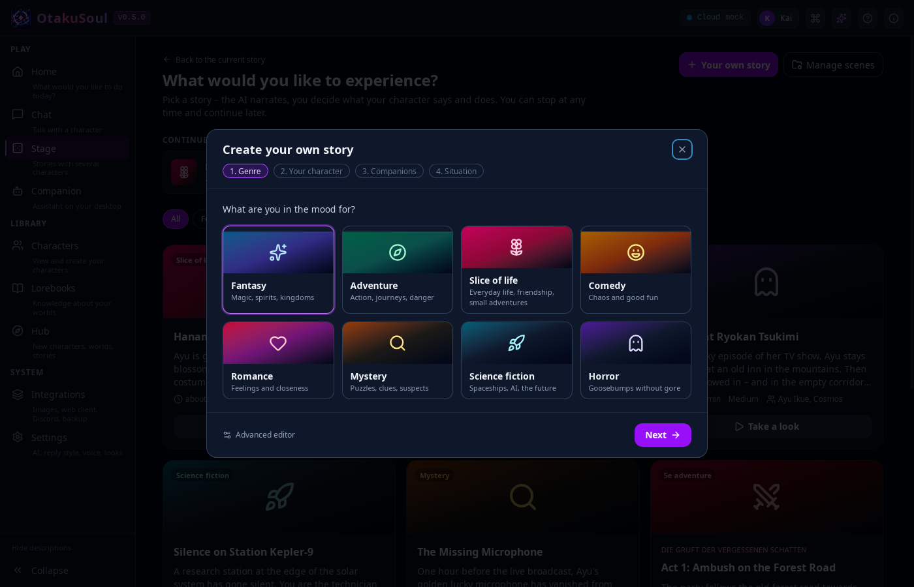
</p>

### 💬 Chat – characters with personality

<p align="center">
  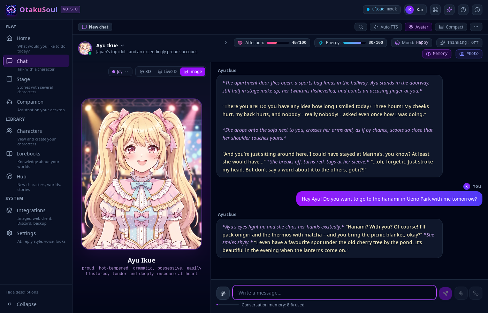
</p>

* The **picture changes with the emotion** of the reply – up to **15 emotion pictures** per character: six moods plus blushing, teasing, fear, disgust, crying and four romance pictures (most Hub characters bring the full set). The AI picks the expression itself; the portrait breathes gently and moves while speaking. Alternatively a **3D avatar** (VRM, MMD, glTF from games) or **Live2D** with lip sync. All models live in **Library → Avatars**: look at them, rename them and give them to characters with a tick.
* **Affection, energy, mood:** the bar at the top shows how the character feels – the AI updates it itself.
* **Replies you don't like?** Generate a new one (swipe), edit it or continue from any message as a new chat.
* **Group chats:** invite more characters into a chat – each keeps their own memory and voice. Choose who answers next or let them talk in rounds.
* **Help with writing:** *What could I say?* suggests replies, *Write for me* drafts your next message, notes in ((double brackets)) steer the AI, the reply length can be set per chat and unwanted words and phrases filtered out.
* **Long chats** stay fast; older parts are summarised automatically so the character never loses the thread.

### 👥 Characters – find, preview, create

<p align="center">
  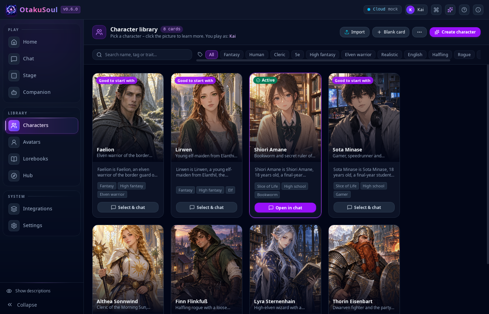
  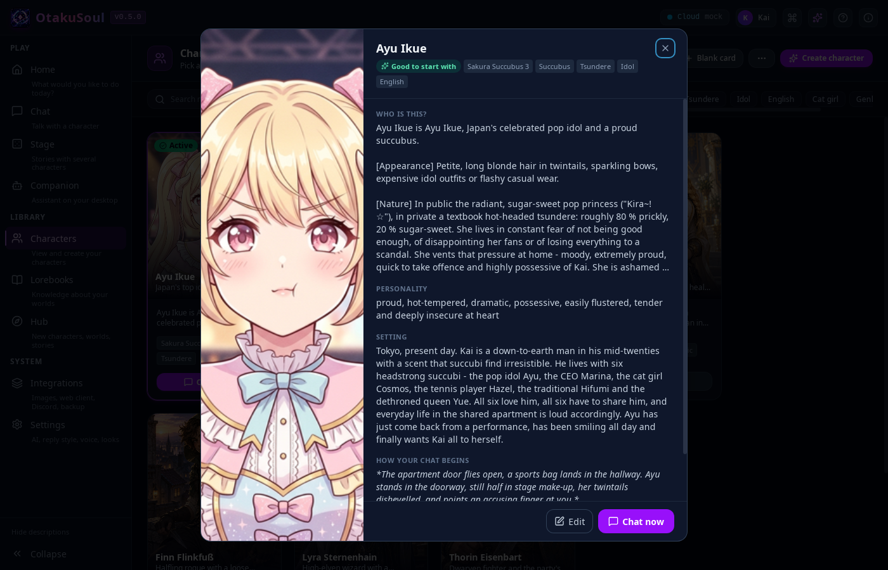
</p>

* **Included:** Shiori Amane, Sota Minase, Lirwen, Faelion and the four heroes of the 5e adventure. *Good to start with* marks the recommended ones.
* **More in the Hub:** characters, worlds and stories (e.g. *No Game No Life*, *Sakura Succubus 3*) in German, English and Russian – with update notices when a new version is available. An optional 18+ section needs a one-time age confirmation and stays hidden otherwise.
* **Create your own:** a guided assistant turns a rough idea into a complete character; SillyTavern cards (PNG/JSON) can be imported and exported.

### 🎲 5e adventures – tactics with real rules

<p align="center">
  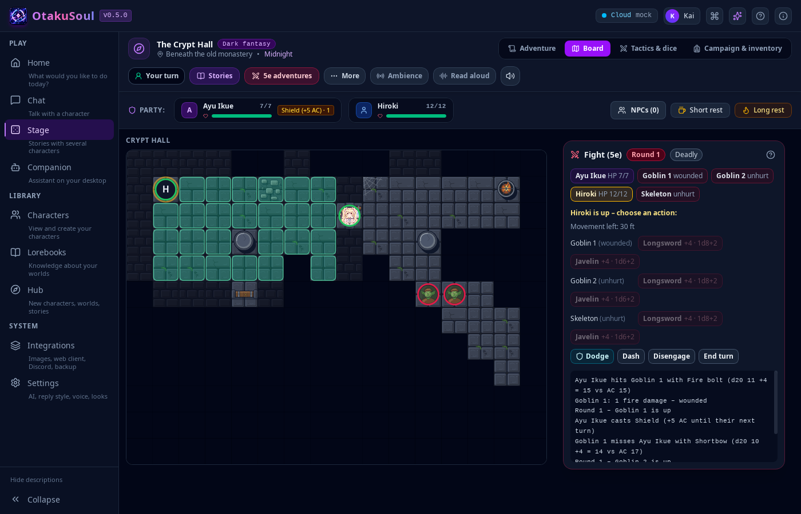
</p>

A rules engine based on the SRD 5.1 decides every roll, hit and enemy move – the AI only narrates. Battle map with movement, reach and line of sight; spells with area preview, conditions, death saves, rests; exploration with fog of war, doors, traps and loot; level-ups to level 3. A short guide explains everything during the first fight.

### 🧠 Memory, voice and more

* **Characters remember you:** after a conversation the memory is updated – beliefs, mood, your relationship, topics and a diary in the first person. For every reply the character recalls the memories that fit the conversation; outdated ones are replaced instead of stored twice (and can be restored). **Plans and promises** (“I'll call you tomorrow”) are kept with a due date and come up again when they are due. *Tidy up memory* merges overlapping entries after you confirm. Every memory shows where it came from and can be corrected, pinned or forgotten.
* **Voices:** speech output and recognition run locally (Qwen3-TTS, Chatterbox, Kokoro, TADA) or via Edge-TTS/ElevenLabs. **Clone a voice** from a short recording – the dialog suggests the best clip; only with the speaker's consent.
* **Pictures:** generate scene pictures locally with stable-diffusion.cpp (SD 1.5 to FLUX.2).
* **Desktop companion:** your character floats above your windows and can search the web, read the clipboard or control music – every sensitive action needs your confirmation.
* **Your language:** German, English and Russian are included. More interface languages come from the Hub or as a JSON file you import in the settings – no new app version needed.
* **On your phone:** chat from your phone or tablet in the same Wi-Fi via QR code.

<p align="center">
  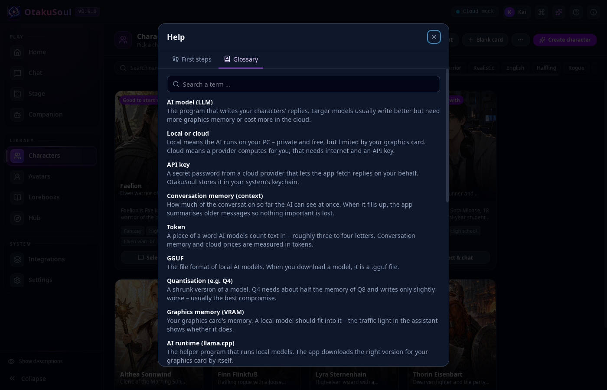
  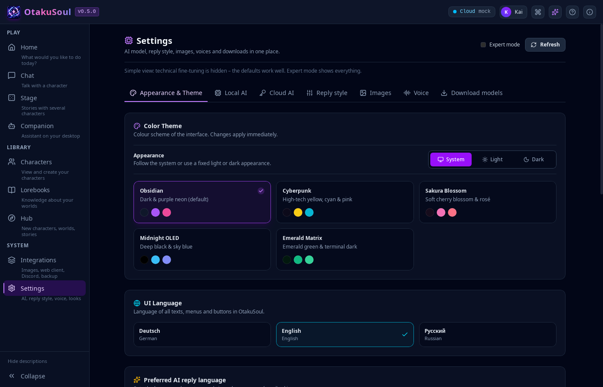
</p>

The **settings** start in a simple view; the *expert mode* adds samplers, server tuning, prompt templates, token counts and logs.

---

## 💻 Is my PC good enough?

| Your PC | Recommendation |
|---|---|
| No dedicated graphics card / laptop | **Cloud AI** – every computer works, you only need an API key. |
| Graphics card with 6–8 GB memory | **Local** with a compact model; the assistant picks a fitting one. |
| 12–16 GB or more | **Local** with large models, plus voice output and local pictures at the same time. |

Disk space: the app itself is small; local models need about 2–15 GB each. Supported graphics cards: NVIDIA (CUDA), AMD and Intel (Vulkan), Apple Silicon (Metal).

---
---

## 🛠️ For power users & developers

### 🧭 Coming from SillyTavern, Backyard AI or Character.ai?

* **All-in-one desktop app:** No separate Node.js or Python runtime to set up, and no external backends to configure manually. Everything runs natively in a single desktop app (Tauri 2 & Rust) with built-in C++ engines for local LLMs, image generation, speech cloning, and 3D/Live2D avatars.
* **Character & lorebook compatible:** Import and export your existing SillyTavern cards (PNG/JSON), Chub characters, and lorebooks seamlessly. Your existing collection works out of the box.
* **Honest note on extensions:** OtakuSoul currently does **not** feature a modular third-party extension/plugin system. Only characters, worlds, and lorebooks can be imported – custom extensions or scripts from other frontends cannot. All features in OtakuSoul are integrated directly into the core app.
* **Beyond chat:** Besides open roleplay chat, OtakuSoul offers guided narrative stories, tactical 5e adventures on a battle map, and an automatic 4-layer cognitive long-term memory in SQLite.

### Feature reference

| Area | Details |
|---|---|
| 💬 **Chat** | Context management with exact token counting (llama-server `/tokenize`) or estimate for cloud, automatic summary of dropped turns, swipes, inline editor with draft protection, attachments (images, PDF, text; local vision via `mmproj`), translation, search (Ctrl+F), bookmarks, branching, per-chat style (background, text size, ambient sound), chat tools (date/time, calculator, web search via a text tool protocol for every provider), prompt log. Group chats (guests with own memory and voice, choice of speaker, automatic rounds), reply suggestions and “write for me”, directions in ((…)), reply length per chat, word & phrase filter, repetition control, visible lorebook and memory hits per reply, “remember this message”, scene picture of a moment (also as chat background), alternative greetings as swipes, card macros (random, dice, time, notes), SillyTavern JSONL export. |
| 🎭 **Avatars** | VRM 0.x/1.0, MMD (PMX/PMD + VMD, spring-bone physics), glTF/GLB (Mixamo/Unreal/Blender/VRoid/Bip001/MMD bone aliases, ARKit morphs, bone-driven faces, embedded clips by role and mood, face editor, toon look), Live2D Cubism 2/4; VRMA and Mixamo FBX motions with retargeting; formant-based visemes. Guide: [Your own 3D model with animations](docs/guide-3d-avatars.md). Up to 15 portrait slots per card (six moods, blush/teasing/fear/disgust/crying, four romance slots), chosen by an invisible `[emotion: …]` tag or by cue words per language (`presets/cues/<lang>.json`); living 2D portrait (breathing, sway, speech motion, off with reduced motion); avatar manager with thumbnails. |
| 🧠 **Cognitive Memory** | Four layers (psyche, relationship, episodic topics, diary) in SQLite; router/archivist/diary agents apply a reflection in one transaction; sources, origin, pinning, review flags and change history; snapshots, import/export and Markdown sync (`MEMORY.md`, `USER.md`). FTS5 full-text search picks the memories that fit each reply (stable core in the system prompt for prompt caching); outdated memories are superseded instead of duplicated and stay restorable; plans and promises with due dates (real time or story time); habits condensed to at most 12 patterns; “tidy up memory” merges overlapping memories after confirmation. |
| 🎲 **Stage** | Two-stage game master (planner + narrator), director with addressing detection and routing, scene-bound NPCs with filtered memories and promotion to full characters, world state (facts, chronicle, arcs with archiving and consistency audits), lore cards, whisper/think/direct modes, auto-play, read-aloud with narrator voice and ambient loops. |
| ⚔️ **5e rules** | Pure Rust engine with injected RNG: SRD monsters/classes/spells/equipment, grid maps with pathfinding, opportunity attacks and line of sight, spell areas, conditions, concentration, reactions (*Shield*), death saves, skills, rests, class features, encounter difficulty from SRD XP, exploration (rooms, traps, locks, exits), multi-act adventures with goals. |
| 🌐 **Hub** | Chub AI browser with lorebook extraction, curated registries from [otakusoul-data](https://github.com/SnowwhiteOakheart/otakusoul-data) with revisions and “update all”; locally modified lorebooks are protected (own copy kept). Story texts written by the app itself refresh from the data repository at start. Optional 18+ source with one-time age confirmation; installed adult content is hidden while it is off. Interface languages (`locales/ui_registry.json`) are fetched at start as well. |
| 🎙️ **Voice** | CrispASR server (no Python): Qwen3-TTS (CustomVoice, Base clone, VoiceDesign), Chatterbox Multilingual/Turbo (sound tags such as `[laugh]`), Kokoro, TADA 3B, F5; whisper.cpp recognition; voice effects (pitch via WSOLA, reverb, echo, filters); clone trimmer with waveform; cloned voices are part of the profile backup. Voice gallery to listen to and compare voices across engines. |
| 🖼️ **Images** | stable-diffusion.cpp server (SD 1.5, SDXL, FLUX.1, Qwen-Image, FLUX.2), catalogue LoRAs only sent to their model family, VRAM planner that shrinks or swaps the chat model in stages and restarts it in the background. |
| 🤖 **Companion** | Transparent always-on-top overlay with click-through, hormone model, MCP client, internal tools with explicit allow-list; code execution off by default; confirmation banner for every sensitive action. |
| 📱 **Web client** | Axum server in the LAN with QR code, token auth and DNS-rebinding protection. |
| 🎨 **UI** | 5 themes plus light mode, DE/EN/RU plus own languages as JSON files (import in the settings, new ones from the data repository, check with `npm run i18n:check`), reset per settings section, command palette (Ctrl+K), keyboard navigation (Ctrl+1…9), WCAG AA contrast, expert mode, background task centre with progress, cancel and retry. |

### Architecture

No Python runtime: every engine is C++ or Rust and is downloaded on demand with SHA-256 verification.

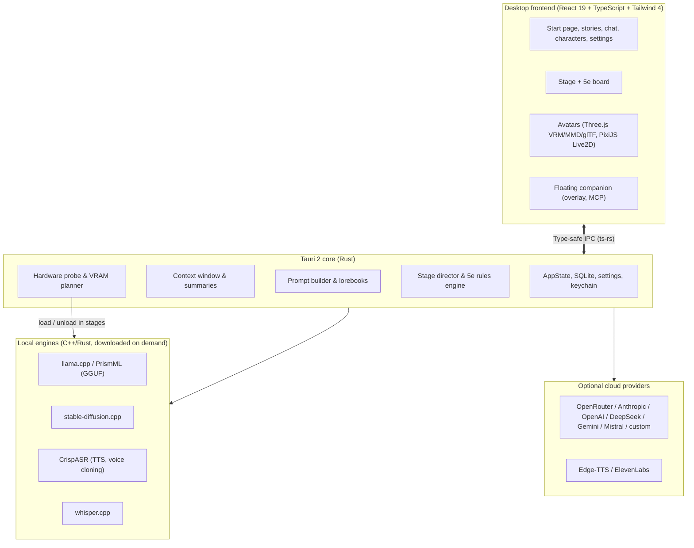

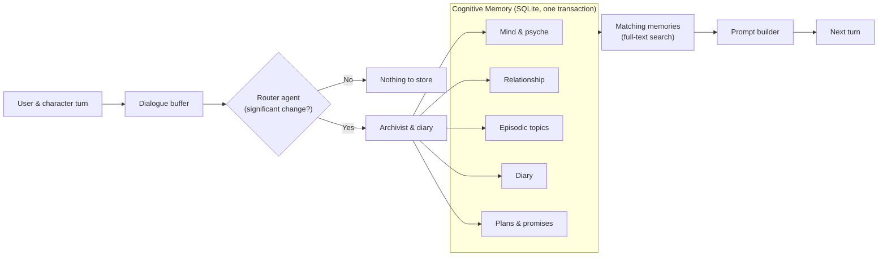

### Measured performance

Reference system: **NVIDIA GeForce RTX 4070 Ti SUPER, 16 GB VRAM**, Linux, CUDA.

**Local images (stable-diffusion.cpp)** – the VRAM planner shares graphics memory with the chat model:

| Model | Time | VRAM | Behaviour |
|---|---|---|---|
| **Counterfeit V3.0** (SD 1.5) | ~15 s | ~2 GB | Entry level for 4 GB cards |
| **Animagine XL 4.0** (SDXL) | ~28 s | ~7.6 GB | Next to a reduced chat model (44 GPU layers) |
| **FLUX.1 dev** (Q5_K_S) | ~48 s | ~9.0 GB | Next to the chat model (26 GPU layers) |
| **Qwen-Image 2.1** (Q4_K) | ~73 s | ~5.6 GB | With CPU offloading |
| **FLUX.2 dev** (Q4_K_S) | ~248 s | ~14.4 GB | Unloads the chat model and reloads it afterwards |

**Speech output (CrispASR)** – intelligibility measured by Whisper back-transcription:

| Model | Voice / mode | German | Russian | English | Real-time factor | VRAM |
|---|---|---|---|---|---|---|
| **Qwen3-TTS 0.6B** CustomVoice | Vivian / Ryan | 100 % | 90 % | 100 % | 0.12–0.13 | +2.3–3.2 GB |
| **Qwen3-TTS 1.7B Base** | own voice clone | 100 % | 100 % | 100 % | 0.15 | +3.3–3.6 GB |
| **Chatterbox Multilingual** | default voice | 92 % | 70 % | – | 0.30–0.55 | +1.8–2.3 GB |
| **Kokoro DE** | Victoria / Bernd / Eva | 77 % | – | – | 0.06–0.23 | +1.0–1.8 GB |

The local chat is ready again 1–4 seconds after an image or speech job.

### Data & privacy

* Profile data lives in the user data folder (`~/.local/share/otakusoul` on Linux, `%APPDATA%\snowwhite\otakusoul\data` on Windows, `~/Library/Application Support/com.snowwhite.otakusoul` on macOS); `OTAKUSOUL_HOME` redirects everything, including the webview storage.
* API keys are stored in the system keychain, never in plain text. The prompt log never contains keys.
* *Integrations → Backup* saves characters, personas, lorebooks, stories, chats and memories, settings and cloned voices in one file – you choose what goes in.

### Other installation options

* **Linux scripts:** `install.sh` installs to `~/.local/bin` with menu entry; Arch: `cd packaging/aur && makepkg -si`.
* **Windows script:** `powershell -ExecutionPolicy Bypass -File .\install.ps1` installs per user with shortcuts.
* **macOS script:** `install-macos.sh` copies the app to *Applications* and removes the quarantine flag.
* **Intel Macs:** no prebuilt package – build from source (below).

### Building from source

Prerequisites: **Node.js** 20+, **Rust** 1.88+; on Linux WebKitGTK 4.1, GTK 3, libsoup 3, librsvg 2.

```bash
npm install
npm run tauri dev          # development with hot reload (Linux: npm run tauri:linux)
npm run tauri build        # installable package for your system
```

Quality checks (there is no CI – everything runs locally):

```bash
npm run check      # oxlint, tsc, vitest, cargo fmt, clippy, cargo test
npm run types:gen  # TypeScript types from Rust structs (ts-rs)
npm run e2e        # end-to-end suite against a mock LLM (tauri-driver)
npm run e2e:perf   # long-chat measurement (1,000 messages)
```

The README screenshots are generated with `xvfb-run -a node e2e/readme-screenshots.mjs en` (or `de`, `ru`). Notes for contributors and AI assistants: [AI.md](AI.md).

### Technology stack

* **Desktop:** [Tauri 2](https://tauri.app/) · **Backend:** [Rust](https://www.rust-lang.org/), [Tokio](https://tokio.rs/), SQLite (`rusqlite`), `reqwest`, `axum`
* **Frontend:** [React 19](https://react.dev/), [TypeScript](https://www.typescriptlang.org/), [Vite](https://vitejs.dev/), [Tailwind CSS 4](https://tailwindcss.com/), [Zustand](https://github.com/pmndrs/zustand)
* **Avatars:** [Three.js](https://threejs.org/), [@pixiv/three-vrm](https://github.com/pixiv/three-vrm), `@moeru/three-mmd`, [PixiJS](https://pixijs.com/) & Live2D Cubism Core
* **Local AI:** llama.cpp & PrismML, stable-diffusion.cpp, CrispASR, whisper.cpp
* **Vibe-coding & AI:** Built primarily through vibe-coding and AI pair-programming with assistance from Claude, ChatGPT, and Gemini (Antigravity) – reinforced by strict typing (`ts-rs`), clippy, e2e tests, and architectural guidelines ([`AI.md`](AI.md)).

---

## ⚖️ License & ethics

OtakuSoul is free software: Copyright (C) 2026 SnowwhiteOakheart.
Licensed under the **GNU General Public License v3.0** (`GPL-3.0-only`).

**Credits:** OtakuSoul began as an independent Rust/Tauri port and redesign of the Python project [Soul of Waifu](https://github.com/jofizcd/Soul-of-Waifu) by [jofizcd](https://github.com/jofizcd) (GPLv3).

**Third-party assets & additional permissions:**
* **Live2D Cubism Core:** `public/live2d/live2dcubismcore.min.js` is (C) Live2D Inc., licensed under the [Live2D Proprietary Software License Agreement](https://www.live2d.com/eula/live2d-proprietary-software-license-agreement_en.html). Permission to link and distribute this component with OtakuSoul is granted pursuant to Section 7 of the GNU GPLv3.
* **Unity-chan:** The Live2D model in `assets/live2d/unitychan` is © Unity Technologies Japan/UCL, provided under the [Unity-Chan License 2.0](https://unity-chan.com/contents/license_en/).
* **3D VRM sample avatars:** `Anime Girl.vrm` and `Anime Man.vrm` in `assets/vrm/` are AvatarSample_Y and AvatarSample_Z by the pixiv VRoid Project (yomox9), provided under the [VRoid Sample Model License](https://vroid.pixiv.help/hc/ja/articles/4402394424089-AvatarSample-A-Z).

**5e rules (SRD 5.1):** the optional rules of the Stage (monsters, classes, spells and equipment in `presets/srd5/` and the rules engine) are based on the SRD 5.1:

> This work includes material taken from the System Reference Document 5.1 ("SRD 5.1") by Wizards of the Coast LLC and available at https://dnd.wizards.com/resources/systems-reference-document. The SRD 5.1 is licensed under the Creative Commons Attribution 4.0 International License available at https://creativecommons.org/licenses/by/4.0/legalcode.

**Models & transparency:**
* No model weights are bundled. Runtimes and models are downloaded from their original source (e.g. Hugging Face) and verified with **SHA-256**.
* Chat models with a restricted or non-commercial licence are offered with a clear note and a link to the licence and are never recommended automatically. Speech models with a non-commercial licence stay locked until you unlock them; non-commercial image models and LoRAs are clearly marked.
* **Responsible voice cloning:** cloning requires confirming the speaker's consent. Generated speech is watermarked by CrispASR (**EU AI Act, Art. 50**).

---

<p align="center">
  <br>
  <em>Infinite Worlds. One Soul.</em>
</p>
