<p align="center">
  
</p>

<p align="center">
  <a href="README.md">🇬🇧 English</a> •
  <a href="README.de.md">🇩🇪 Deutsch</a> •
  <a href="README.ru.md"><strong>🇷🇺 Русский</strong></a>
</p>

<p align="center">
  <strong>Общайся с ИИ-персонажами, играй с ними в истории – и они будут тебя помнить. Приватно, на твоём собственном ПК.</strong><br>
  <em>Приложение для Windows, Linux и macOS. Работает локально на твоей видеокарте или с облачным ИИ на твой выбор.</em>
</p>

<p align="center">
  <a href="https://github.com/SnowwhiteOakheart/OtakuSoul/releases/latest"></a>
  <a href="https://github.com/SnowwhiteOakheart/OtakuSoul/releases"></a>
  <a href="https://github.com/SnowwhiteOakheart/OtakuSoul/stargazers"></a>
  <a href="https://github.com/SnowwhiteOakheart/OtakuSoul/network/members"></a>
  <a href="https://github.com/SnowwhiteOakheart/OtakuSoul/issues"></a>
  
  
  
  
</p>

<p align="center">
  <a href="#-что-такое-otakusoul">Что это?</a> •
  <a href="#-скачать">Скачать</a> •
  <a href="#-первые-десять-минут">Первые шаги</a> •
  <a href="#-экскурсия-по-приложению">Экскурсия</a> •
  <a href="#-подойдёт-ли-мой-пк">Требования</a> •
  <a href="#-для-опытных-пользователей-и-разработчиков">Для опытных</a>
</p>

---

## 🌸 Что такое OtakuSoul?

OtakuSoul – это приложение, в котором **ИИ-персонажи** разговаривают с тобой, играют вместе с тобой в истории и **помнят**, что вы пережили вместе. Выбери персонажа – или создай своего – и просто пиши. ИИ отвечает от лица персонажа: с изображением, настроением, а при желании и с голосом и 3D-аватаром.

<p align="center">
  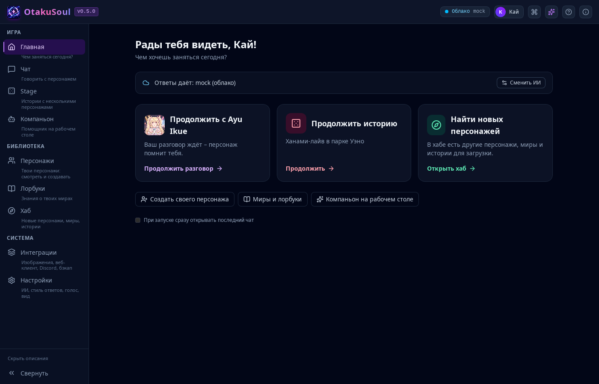
</p>

* 💬 **Общение** с персонажами, у которых есть характер, чувства и память.
* 📖 **Истории:** выбери готовое приключение – ИИ рассказывает, а ты решаешь, что говорит и делает твой персонаж.
* 🎲 **Броски кубиков как за игровым столом:** по желанию правила 5e с игровым полем – движок правил решает, ИИ рассказывает.
* 🔒 **Приватно:** с локальной моделью ничего не покидает твой ПК. Без аккаунта, без телеметрии.
* 🧩 **Без возни:** мастер настройки скачивает всё нужное одним щелчком – без Python и командной строки.

---

## 📥 Скачать

Последняя версия – на **[странице релизов](https://github.com/SnowwhiteOakheart/OtakuSoul/releases/latest)**:

| Система | Файл | Как запустить |
|---|---|---|
| 🪟 **Windows 10 / 11** | `OtakuSoul_0.6.1_x64-setup.exe` | Двойной щелчок и следовать установщику. |
| 🐧 **Linux** (любой дистрибутив) | `OtakuSoul_0.6.1_amd64.AppImage` | Сделать исполняемым (`chmod +x`) и запустить. |
| 🐧 **Debian / Ubuntu** | `OtakuSoul_0.6.1_amd64.deb` | `sudo apt install ./OtakuSoul_0.6.1_amd64.deb` |
| 🍏 **macOS** (Apple Silicon) | `OtakuSoul_0.6.1_aarch64.dmg` | Перетащить OtakuSoul в *Программы*. Приложение не нотариально заверено: при первом запуске правый щелчок → *Открыть* (или `xattr -dr com.apple.quarantine /Applications/OtakuSoul.app`). |

OtakuSoul обновляется сам: когда выходит новая версия, в заголовке появляется кнопка.

---

## 🚀 Первые десять минут

1. **Запусти приложение.** Откроется мастер настройки и спросит язык и цветовую тему.
2. **Выбери ИИ.**
   * **Локально** – приватно и бесплатно. Карточка *«Рекомендуется для твоего ПК»* проверит видеокарту, оперативную память и свободное место на диске и подберёт подходящий набор из **модели чата, изображений и голоса** (с VoiceDesign каждый персонаж сразу говорит своим голосом из описания в карточке). Любую часть можно изменить или пропустить; кнопка *«Да, загрузить всё сейчас»* установит всё в фоне, пока ты идёшь дальше. В разделе *Выбрать самому* светофор показывает, подходят ли отдельные модели к твоему ПК.
   * **Облако** – мощная видеокарта не нужна. Выбери провайдера (OpenRouter, OpenAI, Anthropic, DeepSeek, Gemini, Mistral или свой сервер) и вставь ключ API; ссылка на страницу ключей провайдера – прямо рядом. Проще всего: **«Войти через OpenRouter»** – откроется браузер, войди, готово; без баланса приложение выберет бесплатную модель.
3. **Выбери персонажа** и при желании голос и изображения – и вперёд, в чат или сразу в историю.

<p align="center">
  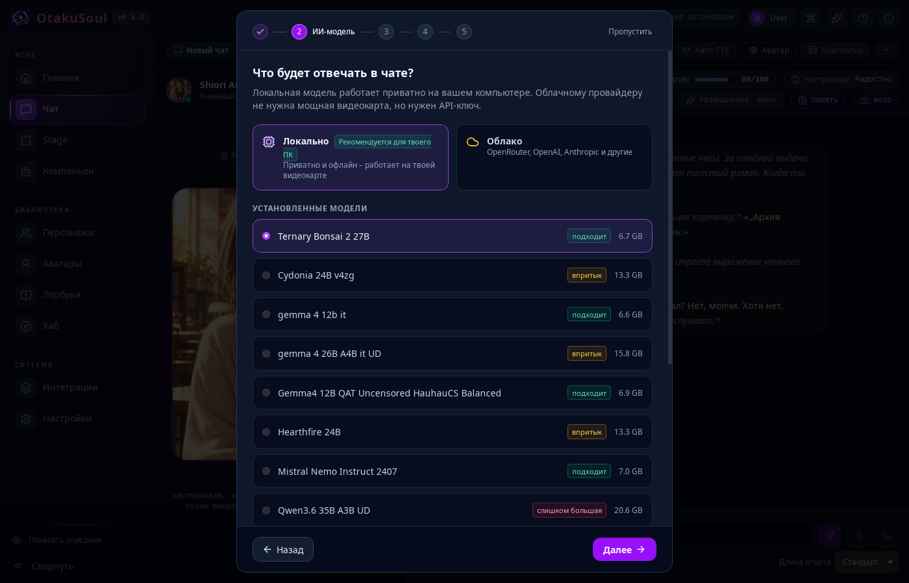
  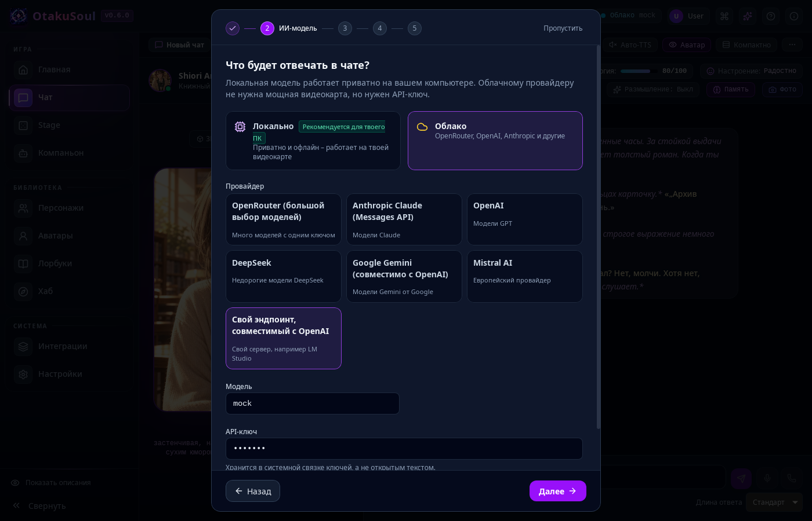
</p>

Что-то не получается? **Знак вопроса** справа вверху открывает *Первые шаги* и **глоссарий**, который объясняет каждый термин одним предложением. У частых ошибок есть кнопка решения («Проверить ключ API», «Выбрать модель поменьше», «Запустить локальный ИИ»). Подробное руководство: **[Первые шаги с OtakuSoul](docs/guide-getting-started.ru.md)**.

---

## 🗺️ Экскурсия по приложению

### 📖 Истории – выбрать, сыграть, продолжить позже

Галерея историй показывает готовые приключения с жанром, длительностью и сложностью; *Для новичков* отмечает простые. У каждой истории есть превью с завязкой, спутниками и идеями для первого хода.

<p align="center">
  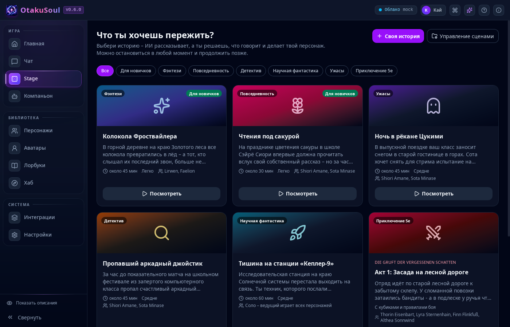
</p>

<p align="center">
  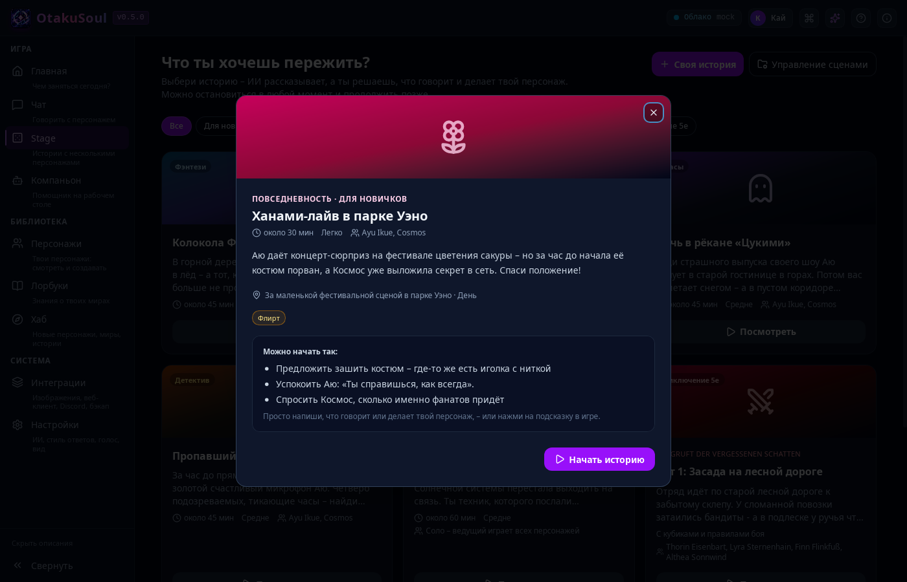
  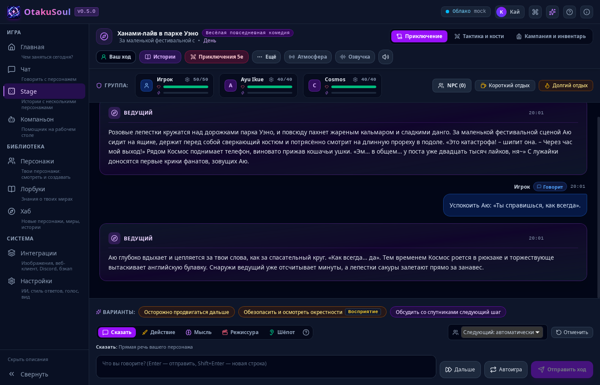
</p>

* **Пять стартовых историй** в комплекте – уютная, весёлая, детектив, страшилка и научная фантастика – плюс приключение 5e *«Склеп забытых теней»* в трёх актах. Связанные истории и серии отображаются как **коллекции** с обложками, а недостающие части можно сразу догрузить из хаба.
* **Как играть:** напиши, что твой персонаж *говорит*, *делает* или *думает*, шепни что-то одному спутнику или дай ведущему *режиссёрское* указание. Спутники сами берут слово и реагируют от своего лица, а не пересказываются ведущим. Нет идей? Нажми на вариант. *Дальше* продолжает историю на раунд без тебя, *Отменить* возвращает последний раунд.
* **Своя история:** мастер историй спросит жанр, твоего персонажа, спутников и завязку – с готовыми идеями для каждого жанра.
* **Спутники с памятью:** персонажи, знакомые тебе по чатам, приносят свои воспоминания в историю и в начале новой сессии рассказывают, что пережили за это время.

<p align="center">
  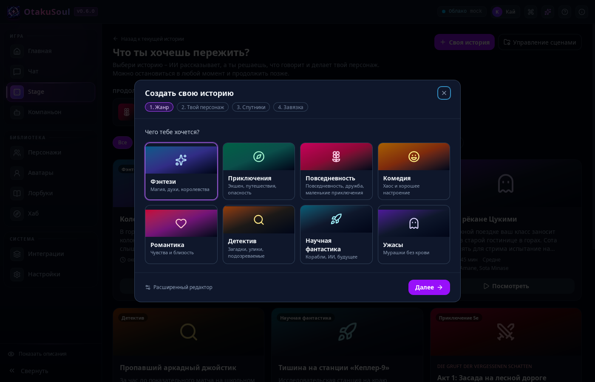
</p>

### 💬 Чат – персонажи с характером

<p align="center">
  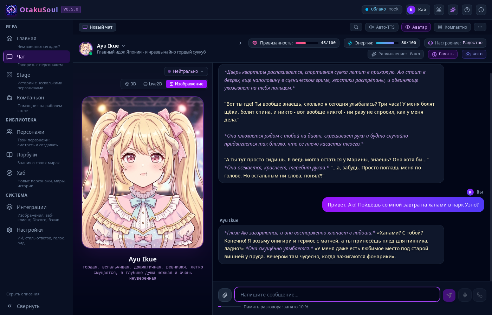
</p>

* **Изображение меняется вместе с эмоцией** ответа – до **15 эмоций** на персонажа: шесть настроений, а также смущение, поддразнивание, страх, отвращение, слёзы и четыре романтических изображения (у большинства персонажей из хаба есть полный набор). Выражение ИИ выбирает сам; портрет слегка дышит и двигается во время речи – а в режиме **говорящего портрета** (Talking Head Anime 3 на процессоре, без нагрузки на видеокарту) даже один статичный рисунок двигает губами в такт речи, моргает и передаёт настроение. Вместо него можно включить **3D-аватар** (VRM, MMD, glTF из игр с загружаемыми наборами движений), **Live2D** или свободную куклу **Inochi2D** (.inp/.inx) с синхронизацией губ и собственными анимациями. Примеры всех типов уже в комплекте, ещё больше – в хабе во вкладке **Аватары**. Все модели собраны в **Библиотека → Аватары**: просмотр, настройка параметров и кадрирования, переименование и назначение персонажам одной галочкой.
* **Привязанность, энергия, настроение:** полоса сверху показывает, как чувствует себя персонаж – ИИ ведёт её сам.
* **Ответ не понравился?** Сгенерируй новый (свайп), отредактируй или продолжи с любого сообщения как новый чат.
* **Групповые чаты:** пригласи в чат ещё персонажей – у каждого своя память и свой голос. Выбирай, кто ответит следующим, или пусть говорят по кругу.
* **Пишет сам:** По желанию персонаж пишет тебе после паузы или спрашивает, когда подходит срок задуманного («Как прошло собеседование?»), а утром рассказывает сон из ваших воспоминаний – а в групповом чате вместо этого, что он тем временем делал с гостем – с временем тишины, дневным лимитом и уведомлением; отдельных персонажей можно отключить.
* **Помощь с текстом:** *Что можно ответить?* предлагает ответы, *Напиши за меня* формулирует твоё следующее сообщение, указания в ((двойных скобках)) направляют ИИ, длину ответа можно задать для каждого чата, а нежелательные слова и обороты – отфильтровать.
* **Длинные чаты** остаются быстрыми: локальная модель хранит память разговора компактно (KV-кэш q8_0, примерно вдвое больше контекста в той же видеопамяти), старые части убираются крупными шагами, чтобы уже обработанный промпт использовался повторно, и автоматически пересказываются, чтобы персонаж не терял нить.

### 👥 Персонажи – найти, посмотреть, создать

<p align="center">
  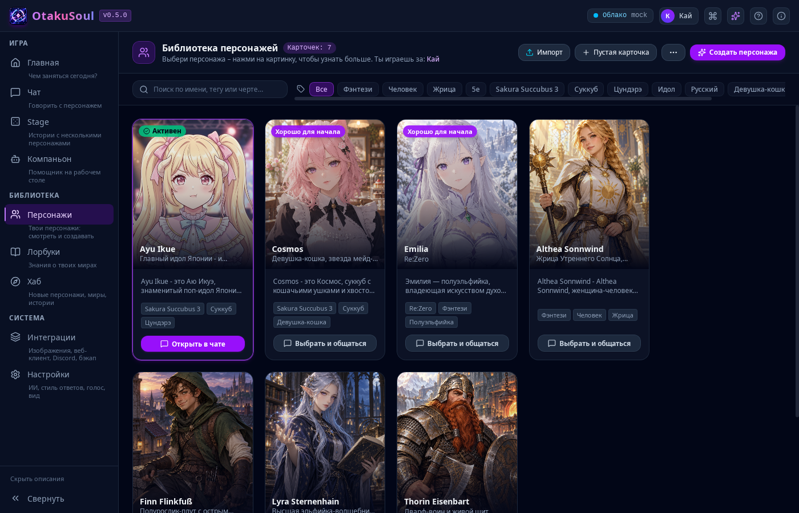
  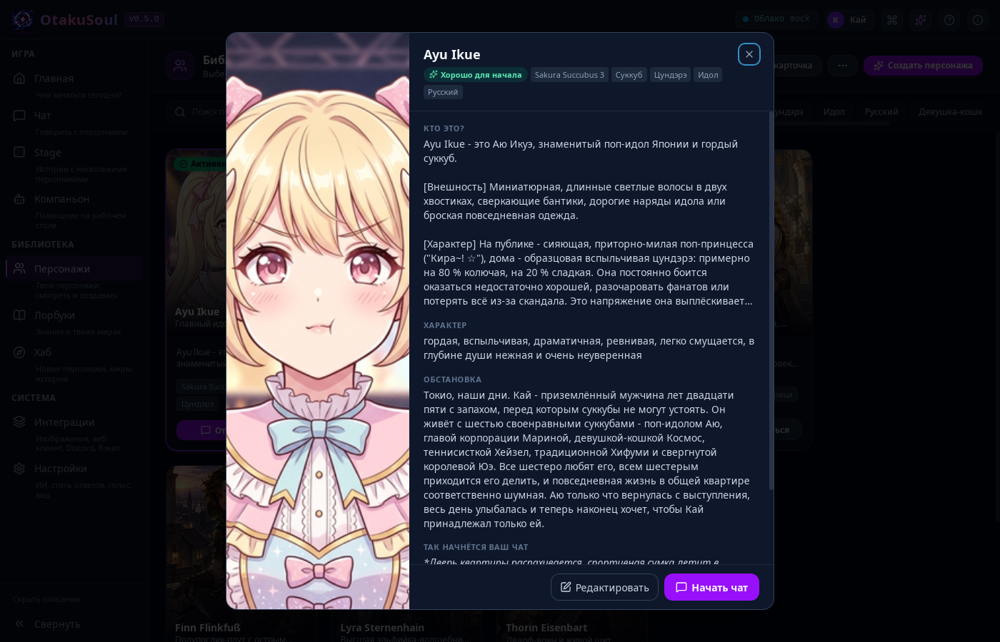
</p>

* **В комплекте:** Сиори Аманэ, Сота Минасэ, Лирвен, Фаэлион и четыре героя приключения 5e. *Хорошо для начала* отмечает рекомендуемых.
* **Больше в хабе:** более 65 персонажей, почти 60 сцен и историй, 27 лорбуков и свободные **аватары** 3D, Live2D и Inochi2D, например миры *Frieren*, *Re:Zero*, *Sword Art Online* или *No Game No Life* – на немецком, английском и русском – с уведомлением, когда выходит новая версия. **Коллекции** объединяют персонажей, лорбуки и сцены одной истории на карточке с обложкой и кнопкой *«Установить всё»*. Необязательный раздел 18+ требует однократного подтверждения возраста и иначе скрыт.
* **Создать своего:** пошаговый мастер превращает смутную идею в готового персонажа; карточки SillyTavern (PNG/JSON) можно импортировать и экспортировать.

### 🎲 Приключения 5e – тактика по настоящим правилам

<p align="center">
  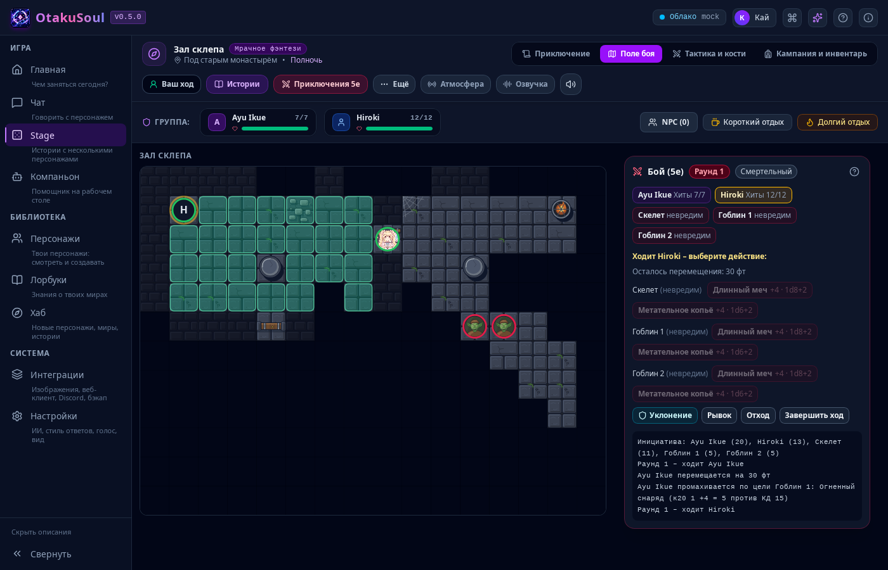
</p>

Движок правил на основе SRD 5.1 решает каждый бросок, попадание и ход противника – ИИ только рассказывает. Игровое поле с перемещением, дальностью и линией обзора; заклинания с предпросмотром области, состояния, спасброски от смерти, отдых; исследование с туманом войны, дверями, ловушками и добычей; повышение уровня до 3-го. Короткая подсказка объясняет всё в первом бою.

### 🧠 Память, голос и не только

* **Персонажи помнят тебя:** после разговора память обновляется – убеждения, настроение, ваши отношения, темы и дневник от первого лица. К каждому ответу персонаж подбирает воспоминания, подходящие к разговору; устаревшие заменяются, а не дублируются (и их можно восстановить). **Планы и обещания** («Позвоню тебе завтра») запоминаются со сроком и всплывают, когда приходит время. *Навести порядок в памяти* объединяет пересекающиеся записи после твоего подтверждения. Каждое воспоминание показывает свой источник; его можно исправить, закрепить или забыть.
* **Голоса и голосовой звонок:** синтез и распознавание речи работают локально (Qwen3-TTS, Chatterbox, Kokoro, TADA) или через Edge-TTS/ElevenLabs. Во время **голосового звонка** персонажа можно в любой момент **перебить** – озвучка и генерация сразу остановятся, твоя реплика бесшовно станет следующим ходом, а ответ сохранится ровно до того места, которое ты успел услышать. Кнопка *«Сказать фразу»* за один проход проверяет уровень микрофона, распознавание и голос персонажа. **Клонирование голоса** по короткой записи – диалог сам предложит лучший фрагмент; только с согласия говорящего. По желанию **голос рассказчика** читает *действия*, а персонаж произносит свои реплики – как в аудиоспектакле.
* **Голоса с характером:** Qwen3-TTS 1.7B говорит в выбранном стиле и с чувством – шёпотом, грустно, взволнованно – под стать ответу. Карточка может описать свой голос (тембр, возраст, темп), а VoiceDesign создаёт по таким описаниям несколько голосов.
* **Изображения:** сцены можно рисовать локально через stable-diffusion.cpp (от SD 1.5 до FLUX.2). Персонаж выглядит как на своём портрете и по желанию присылает тебе **селфи** в чат.
* **Модели, адаптеры и замер скорости:** загрузки идут сразу в 8 соединений и продолжаются после обрыва, даже после перезапуска; разделённые GGUF-файлы и подходящий файл зрения загружаются вместе. Каждая модель хранит свои настройки, поддерживает **адаптеры (LoRA)** для литературного стиля или ролевой игры без цензуры, а кнопка *«Проверить скорость»* измеряет и сравнивает быстродействие прямо на твоём ПК.
* **Питомец на рабочем столе и компаньон:** персонаж свободно живёт на рабочем столе как **3D-аватар, модель Live2D, кукла Inochi2D или говорящий портрет** (клики мимо фигуры проходят насквозь, плавный масштаб по `Ctrl + колесо мыши`, мягкая тень под ногами). Он ходит с гравитацией между несколькими мониторами, его можно перетаскивать и бросать, а в Windows он стоит, сидит, запрыгивает на грани окон и ездит вместе с ними. Гормоны и время суток влияют на поведение (ночью говорит тише, от аккумулятора экономит заряд, в полноэкранном режиме ставится на паузу, кивает в такт музыке). Он реагирует на поглаживание по голове, «дай пять» и держание за руку, прибегает к курсору по команде *«Иди сюда»*, показывает ответы фраза за фразой синхронно с голосом и позволяет быстро написать прямо рядом с ним (*«Сказать что-нибудь …»*). Переключается из трея или настраиваемым сочетанием клавиш (`Ctrl+Alt+Shift+P`); как компаньон умеет искать в интернете, читать буфер обмена или управлять музыкой – любое чувствительное действие требует твоего подтверждения.
* **Твой язык:** немецкий, английский, русский и японский уже есть. Другие языки интерфейса приходят из хаба или как JSON-файл, который ты импортируешь в настройках, – без новой версии приложения.
* **С телефона:** в той же Wi-Fi-сети можно общаться со смартфона или планшета через QR-код.

<p align="center">
  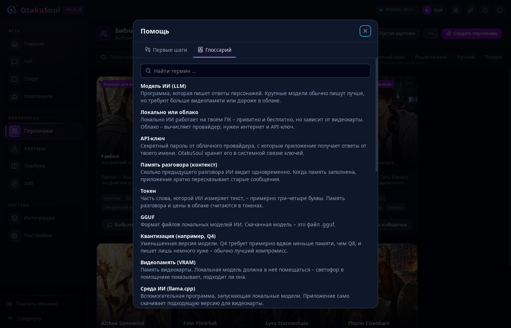
  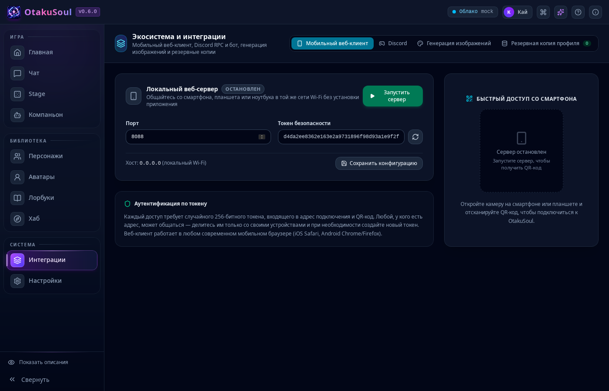
</p>

**Настройки** открываются в простом виде; *режим эксперта* добавляет сэмплеры, тонкую настройку сервера, шаблоны промптов, счётчики токенов и журналы.

---

## 💻 Подойдёт ли мой ПК?

| Твой ПК | Рекомендация |
|---|---|
| Без отдельной видеокарты / ноутбук | **Облачный ИИ** – работает на любом компьютере, нужен только ключ API. |
| Видеокарта с 6–8 ГБ памяти | **Локально** с компактной моделью (Gemma 4 E4B, Qwen3.5 9B); мастер подберёт подходящую. |
| 10–16 ГБ | **Локально** с Gemma 4 12B – быстрая, видит изображения, остаётся место для озвучки и локальных изображений одновременно. |
| 20 ГБ и больше | **Локально** с большими моделями (Qwen3.6 35B-A3B от 20 ГБ, Gemma 4 31B от 24 ГБ). |

Место на диске: само приложение небольшое; локальные модели занимают примерно 3–22 ГБ каждая. Поддерживаемые видеокарты: NVIDIA (CUDA), AMD и Intel (Vulkan), Apple Silicon (Metal).

---
---

## 🛠️ Для опытных пользователей и разработчиков

### 🧭 Переход с SillyTavern, Backyard AI или Character.ai?

* **Единое настольное приложение:** Не нужно настраивать Node.js, окружение Python или вручную подключать внешние серверы. Всё работает нативно в одном приложении (Tauri 2 и Rust) со встроенными движками для локальных LLM, генерации картинок, клонирования голоса, говорящих 2D-портретов и аватаров 3D, Live2D и Inochi2D.
* **Совместимость с карточками и лорбуками:** Ваши карточки SillyTavern (PNG/JSON), персонажи Chub и лорбуки импортируются и экспортируются без проблем. Вся текущая коллекция работает сразу.
* **Что можно перенести:** кроме персонажей, миров и лорбуков также **regex-скрипты** SillyTavern, **наборы быстрых ответов**, пресеты сэмплеров и системные промпты. Regex-скрипты действуют на твои сообщения, ответы, только на отображение или только на промпт.
* **Честно о расширениях:** системы плагинов для стороннего кода (пока) нет – расширения из других фронтендов и команды STscript (slash-команды в быстрых ответах) не работают; импорт их пропускает и сообщает, сколько их было. Instruct- и контекстные шаблоны не нужны, потому что OtakuSoul использует шаблон чата самой модели.
* **Больше, чем чат:** Помимо свободного ролевого чата, OtakuSoul предлагает сюжетные истории, тактические приключения по правилам 5e на клеточном поле и автоматическую четырёхслойную когнитивную долговременную память в SQLite.

### Обзор возможностей

| Область | Подробности |
|---|---|
| 💬 **Чат** | Управление контекстом с точным подсчётом токенов (llama-server `/tokenize`) или оценкой для облака, автоматический пересказ выпавших раундов, сокращение шагами в четверть окна, чтобы срабатывал кэш промпта, KV-кэш по умолчанию q8_0 (V-кэш f16 без flash attention), свайпы, встроенный редактор с защитой черновиков, вложения (изображения, PDF, текст; локальное зрение через `mmproj`), перевод, поиск (Ctrl+F), закладки, ветвление, оформление каждого чата (фон, размер текста, фоновый звук), инструменты чата (дата/время, калькулятор, веб-поиск через текстовый протокол инструментов для любого провайдера), журнал промптов. Групповые чаты (гости со своей памятью и голосом, выбор говорящего, автоматические раунды), варианты ответа и «Напиши за меня», указания в ((…)), длина ответа для каждого чата, фильтр слов и оборотов, борьба с повторами, видимые совпадения лорбука и памяти к каждому ответу, «Запомнить это сообщение», картинка момента (и как фон чата), альтернативные приветствия как свайпы, макросы карточек (случай, кости, время, заметки), экспорт SillyTavern JSONL. |
| 🎭 **Аватары** | VRM 0.x/1.0, MMD (PMX/PMD + VMD, физика spring bone), glTF/GLB (алиасы костей Mixamo/Unreal/Blender/VRoid/Bip001/MMD, морфы ARKit, лица на костях, встроенные клипы по роли и настроению, редактор лица, тун-шейдинг), Live2D Cubism 2/4, куклы Inochi2D (собственная среда WebGL2 по Inox2D: маски, композиты, группы сеток, кубические привязки, маятниковая физика, декодирование текстур в Web Worker; 3-слойный аниматор с циклами покоя/ходьбы/сидения, клипами эмоций и жестов; гласные формы рта `A/I/U/E/O`, моргание, взгляд и эмоции по именам параметров и редактор *Управление куклой*; Aka в комплекте, остальные в хабе + подсказка для скачивания в чате); движения VRMA и Mixamo FBX с ретаргетингом, загружаемые **наборы движений** (`motion_packs_registry.json`, напр. Quaternius CC0), роли для речи/танца/падения/сна/прыжка/приземления/зевоты и процедурная осанка; формы рта по формантам. Руководство: [Своя 3D-модель с анимациями](docs/guide-3d-avatars.ru.md). До 15 мест для портретов на карточку (шесть настроений, смущение/поддразнивание/страх/отвращение/слёзы, четыре романтических), выбор через `[emotion: …]` или слова-подсказки (`presets/cues/<язык>.json`); **говорящие портреты** через Talking Head Anime 3 + anime-seg как ONNX на CPU (патчи пикселей рассчитываются один раз для форм рта `aa/ih/ou/ee/oh`, моргания и пяти настроений без нагрузки при речи, в том числе для изображений из хаба и портретного питомца) и живой 2D-портрет (дыхание, покачивание); менеджер аватаров с миниатюрами и настройкой кадрирования питомца для каждой модели. |
| 🧠 **Когнитивная память** | Четыре слоя (психика, отношения, эпизодические темы, дневник) в SQLite; агенты-маршрутизатор, архивариус и дневник записывают рефлексию одной транзакцией; источники, происхождение, закрепление, пометки для проверки и история изменений; снимки, импорт/экспорт и синхронизация с Markdown (`MEMORY.md`, `USER.md`). Полнотекстовый поиск FTS5 подбирает воспоминания к каждому ответу (стабильное ядро в системном промпте ради кэша промптов); устаревшие воспоминания заменяются, а не дублируются, и их можно восстановить; планы и обещания со сроком (реальное время или время истории); привычки сводятся максимум к 12 шаблонам; «Навести порядок в памяти» объединяет пересечения после подтверждения. |
| 🎲 **Stage** | Двухступенчатый ведущий (планировщик + рассказчик), режиссура с распознаванием обращений, маршрутизацией и гарантией реплик спутников, NPC сцены с отфильтрованной памятью и повышением до полноценных персонажей, состояние мира (факты, хроника, сюжетные арки с архивированием и проверкой согласованности), карточки лора, шёпот/мысли/режиссура, автоигра, озвучка голосом рассказчика и фоновые петли; галерея историй с коллекциями и обложками. |
| ⚔️ **Правила 5e** | Чистый движок на Rust с внедрённым генератором случайных чисел: монстры/классы/заклинания/снаряжение SRD, клеточные карты с поиском пути, атаками по возможности и линией обзора, области заклинаний, состояния, концентрация, реакции (*Щит*), спасброски от смерти, навыки, отдых, умения классов, сложность встреч по опыту SRD, исследование (комнаты, ловушки, замки, выходы), многоактные приключения с целями. |
| 🌐 **Хаб и модели** | Браузер Chub AI с извлечением лорбуков, курируемые реестры из [otakusoul-data](https://github.com/SnowwhiteOakheart/otakusoul-data) с ревизиями, «Обновить всё», отдельной вкладкой **Аватары** (`avatars_registry.json`: VRM, Live2D, Inochi2D по SHA-256 или переход к источнику) и **коллекциями** по историям (`collections_registry.json`: персонажи, лорбуки и сцены в одном наборе с кнопкой «Установить всё», в том числе в галерее историй); локально изменённые лорбуки защищены (своя версия сохраняется копией). Игровые тексты, языки интерфейса (`locales/ui_registry.json`), каталог кукол Inochi2D и наборы движений обновляются из репозитория данных при запуске. Необязательный источник 18+ с однократным подтверждением возраста; установленный контент для взрослых и адаптеры без цензуры скрыты, пока он выключен. Загрузка моделей в 8 параллельных соединений с продолжением (и после перезапуска), разделённые GGUF, файлы зрения (`mmproj`); мастер первичной настройки с подбором набора (чат + открытая модель изображений + VoiceDesign/TTS с проверкой VRAM и места на диске); **LoRA-адаптеры для чата** по базовой модели (`chat_loras` для стиля/аблитерации, а также свои GGUF и сила 0–2 в режиме эксперта); встроенный **замер скорости** локальной чат-модели (скорость чтения и генерации, время до первого ответа, VRAM, оценка и история последних 50 запусков). |
| 🎙️ **Голос** | Сервер CrispASR (без Python): Qwen3-TTS (CustomVoice 0.6B/1.7B со стилем речи и эмоциями, клон Base, VoiceDesign с несколькими созданными голосами, описание голоса из карточки), Chatterbox Multilingual/Turbo (звуковые теги вроде `[laugh]`), Kokoro, TADA 3B, F5; распознавание через whisper.cpp; **перебивание в звонке (barge-in)** (прослушивание выше 2,5× порога VAD, бесшовный переход к следующему ходу, обрезка сохранённого ответа по реально услышанному); **проверка микрофона** (*«Сказать фразу»*: уровень, диагностика VAD с предложением порога, расшифровка Whisper и повтор голосом персонажа с движением губ); голосовые эффекты (высота тона через WSOLA, реверберация, эхо, фильтры); обрезка записи для клона с волновой формой; клонированные голоса в бэкапе профиля; галерея голосов по всем движкам. |
| 🖼️ **Изображения** | Сервер stable-diffusion.cpp (SD 1.5, SDXL, FLUX.1, Qwen-Image, FLUX.2), LoRA из каталога только для своего семейства моделей, планировщик VRAM, который поэтапно уменьшает или выгружает чат-модель и перезапускает её в фоне. |
| 🤖 **Питомец и компаньон** | Отдельное прозрачное окно поверх остальных для **3D-аватаров, Live2D, Inochi2D и (говорящих) 2D-портретов** с попиксельным пропуском кликов через глобальный курсор, плавным размером (`Ctrl + колесо мыши`, запоминается для каждой модели) и мягкой тенью под ногами; физика с гравитацией, броском и отскоком, ходьбой между несколькими мониторами; в Windows – стояние, ходьба, сидение, **прыжки/залезание** и поездка на видимых гранях окон, кивание в такт системному звуку (WASAPI), пауза в полноэкранном режиме и при блокировке экрана, а также переход в чат по клику на уведомление; поведение по гормонам и времени суток, тихий голос ночью (23:00–06:00), экономия от аккумулятора, проекция зон головы и рук (поглаживание, «дай пять», держание за руку, тычок), *«Иди сюда»* к курсору, речевые облачка с указателем и автопрокруткой синхронно с озвучкой, приветствия при собственных сообщениях, быстрый чат у питомца, вкладка с предпросмотром, меню трея и настраиваемое глобальное сочетание клавиш (`Ctrl+Alt+Shift+P`). Плюс клиент MCP и внутренние инструменты по списку разрешений (выполнение кода по умолчанию выключено, баннер подтверждения для каждого чувствительного действия). |
| 📱 **Веб-клиент** | Сервер Axum в локальной сети с QR-кодом, токен-авторизацией и защитой от DNS-rebinding. |
| 🎨 **Интерфейс** | 5 тем и светлый режим, DE/EN/RU/JA и свои языки в виде JSON-файлов (импорт в настройках, новые из репозитория данных, проверка `npm run i18n:check`), прокрутка перетаскиванием мыши в библиотеках и хабе, диалог закрытия окна (свернуть в трей или выйти, с *«Запомнить выбор»*), сброс по разделам настроек, палитра команд (Ctrl+K), навигация с клавиатуры (Ctrl+1…9), контраст WCAG AA, режим эксперта, центр фоновых задач с прогрессом, отменой и повтором. |

### Архитектура

Без Python: все движки написаны на C++ или Rust, загружаются по необходимости и проверяются по SHA-256.

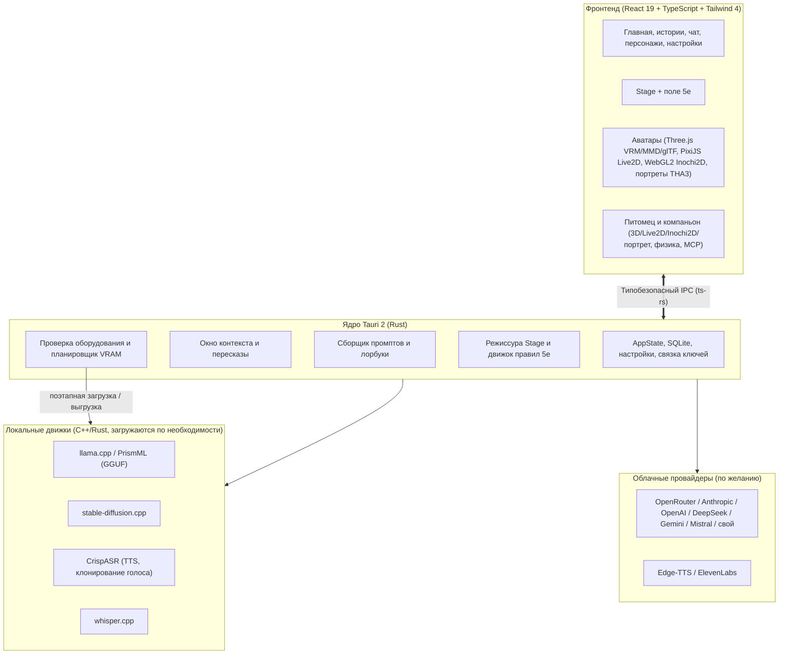

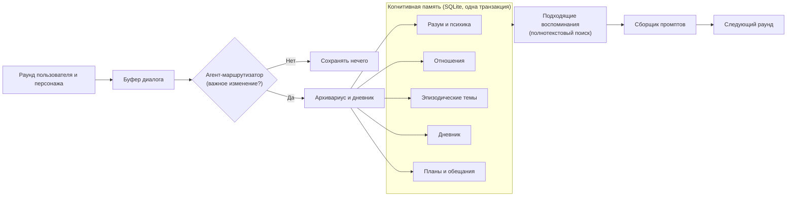

### Измеренная производительность

Эталонная система: **NVIDIA GeForce RTX 4070 Ti SUPER, 16 ГБ VRAM**, Linux, CUDA.

**Чат-модели (llama.cpp, контекст 4–8K, модель изображений загружена параллельно)** – по тестам сцены, группового чата и лорбуков:

| Модель | Скорость | VRAM | Примечание |
|---|---|---|---|
| **Gemma 4 E4B** (Q4_K_M) | 73–81 токенов/с | ~5,8 ГБ | Лучший общий результат, видит изображения |
| **Gemma 4 12B** (Q4_K_M) | 43–46 токенов/с | ~8,9 ГБ | Рекомендуется для 10–16 ГБ, видит изображения |
| **Gemma 4 26B-A4B** (MoE) | 20–22 токенов/с | ~11,3 ГБ | На 16 ГБ частично выгружена |
| **Qwen3.6 35B-A3B** (MoE) | 18–19 токенов/с | ~11,1 ГБ | На 16 ГБ частично выгружена |

**Локальные изображения (stable-diffusion.cpp)** – планировщик VRAM делит видеопамять с чат-моделью:

| Модель | Время | VRAM | Поведение |
|---|---|---|---|
| **Counterfeit V3.0** (SD 1.5) | ~15 с | ~2 ГБ | Начальный уровень для карт с 4 ГБ |
| **Animagine XL 4.0** (SDXL) | ~28 с | ~7,6 ГБ | Рядом с уменьшенной чат-моделью (44 слоя на GPU) |
| **FLUX.1 dev** (Q5_K_S) | ~48 с | ~9,0 ГБ | Рядом с чат-моделью (26 слоёв на GPU) |
| **Qwen-Image 2.1** (Q4_K) | ~73 с | ~5,6 ГБ | С выгрузкой на CPU |
| **FLUX.2 dev** (Q4_K_S) | ~248 с | ~14,4 ГБ | Выгружает чат-модель и потом загружает снова |

**Синтез речи (CrispASR)** – разборчивость измерена обратным распознаванием Whisper:

| Модель | Голос / режим | Немецкий | Русский | Английский | Коэфф. реального времени | VRAM |
|---|---|---|---|---|---|---|
| **Qwen3-TTS 0.6B** CustomVoice | Vivian / Ryan | 100 % | 90 % | 100 % | 0,12–0,13 | +2,3–3,2 ГБ |
| **Qwen3-TTS 1.7B Base** | свой клон голоса | 100 % | 100 % | 100 % | 0,15 | +3,3–3,6 ГБ |
| **Chatterbox Multilingual** | стандартный голос | 92 % | 70 % | – | 0,30–0,55 | +1,8–2,3 ГБ |
| **Kokoro DE** | Victoria / Bernd / Eva | 77 % | – | – | 0,06–0,23 | +1,0–1,8 ГБ |

Локальный чат снова готов через 1–4 секунды после генерации изображения или речи.

### Данные и приватность

* Данные профиля хранятся в папке пользовательских данных (`~/.local/share/otakusoul` в Linux, `%APPDATA%\snowwhite\otakusoul\data` в Windows, `~/Library/Application Support/com.snowwhite.otakusoul` в macOS); `OTAKUSOUL_HOME` перенаправляет всё, включая хранилище webview.
* Ключи API хранятся в системной связке ключей, никогда открытым текстом. Журнал промптов ключей не содержит.
* *Интеграции → Бэкап* сохраняет персонажей, персоны, лорбуки, истории, чаты и воспоминания, настройки и клонированные голоса в один файл – ты выбираешь, что туда войдёт.

### Другие способы установки

* **Скрипты для Linux:** `install.sh` устанавливает в `~/.local/bin` с пунктом меню; Arch: `cd packaging/aur && makepkg -si`.
* **Скрипт для Windows:** `powershell -ExecutionPolicy Bypass -File .\install.ps1` устанавливает для текущего пользователя с ярлыками.
* **Скрипт для macOS:** `install-macos.sh` копирует приложение в *Программы* и снимает карантинную метку.
* **Mac на Intel:** готового пакета нет – собрать из исходников (см. ниже).

### Сборка из исходников

Требования: **Node.js** 20+, **Rust** 1.88+; в Linux – WebKitGTK 4.1, GTK 3, libsoup 3, librsvg 2.

```bash
npm install
npm run tauri dev          # разработка с горячей перезагрузкой (Linux: npm run tauri:linux)
npm run tauri build        # устанавливаемый пакет для твоей системы
```

Проверки качества (CI для проверок нет – всё запускается локально; GitHub Actions только собирает релизные пакеты):

```bash
npm run check      # oxlint, tsc, vitest, cargo fmt, clippy, cargo test
npm run types:gen  # типы TypeScript из структур Rust (ts-rs)
npm run e2e        # сквозные тесты против мок-LLM (tauri-driver)
npm run e2e:perf   # замер длинного чата (1000 сообщений)
```

Скриншоты для README создаются командой `xvfb-run -a node e2e/readme-screenshots.mjs ru` (или `de`, `en`). Заметки для участников и ИИ-ассистентов: [AI.md](AI.md).

### Технологии

* **Десктоп:** [Tauri 2](https://tauri.app/) · **Бэкенд:** [Rust](https://www.rust-lang.org/), [Tokio](https://tokio.rs/), SQLite (`rusqlite`), `reqwest`, `axum`
* **Фронтенд:** [React 19](https://react.dev/), [TypeScript](https://www.typescriptlang.org/), [Vite](https://vitejs.dev/), [Tailwind CSS 4](https://tailwindcss.com/), [Zustand](https://github.com/pmndrs/zustand)
* **Аватары:** [Three.js](https://threejs.org/), [@pixiv/three-vrm](https://github.com/pixiv/three-vrm), `@moeru/three-mmd`, [PixiJS](https://pixijs.com/) и Live2D Cubism Core, среда Inochi2D (портирована из [Inox2D](https://github.com/Inochi2D/inox2d))
* **Локальный ИИ:** llama.cpp и PrismML, stable-diffusion.cpp, CrispASR, whisper.cpp, ONNX Runtime (`ort`, для Kokoro и Talking Head Anime 3)
* **Вайб-кодинг и ИИ:** Создано преимущественно через вайб-кодинг и парное программирование с ИИ при поддержке Claude, ChatGPT и Gemini (Antigravity) — с контролем строгой типизации (`ts-rs`), clippy, сквозных e2e-тестов и архитектурных правил ([`AI.md`](AI.md)).

---

## ⚖️ Лицензия и этика

OtakuSoul – свободное ПО: Copyright (C) 2026 SnowwhiteOakheart.
Выпущено под лицензией **GNU General Public License v3.0** (`GPL-3.0-only`).

**Благодарности:** OtakuSoul появился как самостоятельный порт на Rust/Tauri и переработка Python-проекта [Soul of Waifu](https://github.com/jofizcd/Soul-of-Waifu) от [jofizcd](https://github.com/jofizcd) (GPLv3).

**Компоненты сторонних авторов и дополнительные разрешения:**
* **Live2D Cubism Core:** `public/live2d/live2dcubismcore.min.js` – (C) Live2D Inc., по лицензии [Live2D Proprietary Software License Agreement](https://www.live2d.com/eula/live2d-proprietary-software-license-agreement_en.html). Разрешение на связывание и распространение с OtakuSoul предоставлено в соответствии с разделом 7 GNU GPLv3.
* **Inox2D:** `src/services/inochi2d/` – перенос Inox2D на TypeScript © Speykious и Inochi2D Project, шейдеры © Luna Nielsen, по [лицензии BSD 2-Clause](src/services/inochi2d/LICENSE-inox2d.txt). **Пример куклы Inochi2D:** `assets/inochi2d/Aka.inx` – «Aka» от seagetch (дизайн и риггинг) из [Inochi2D/example-models](https://github.com/Inochi2D/example-models), лицензия [CC BY 4.0](https://creativecommons.org/licenses/by/4.0/), включена без изменений (подробности в `assets/inochi2d/lizenzen.txt`). Midori (тоже © seagetch, CC BY 4.0) не входит в комплект и загружается из источника по запросу.
* **Unity-chan:** Модель Live2D в `assets/live2d/unitychan` – © Unity Technologies Japan/UCL, распространяется по [Unity-Chan License 2.0](https://unity-chan.com/contents/license_en/).
* **Примеры моделей Live2D:** `assets/live2d/` содержит образцы аватаров (Hiyori, Haru, Rice, Tsumiki) от Live2D Inc. по лицензии [Live2D Free Material License Agreement](https://www.live2d.com/eula/live2d-free-material-license-agreement_en.html) (подробности в `assets/live2d/lizenzen.txt`).
* **Базовые 3D-аватары VRM:** `Anime Girl.vrm` и `Anime Man.vrm` в `assets/vrm/` – модели AvatarSample_Y и AvatarSample_Z от pixiv VRoid Project (yomox9) по лицензии [VRoid Sample Model License](https://vroid.pixiv.help/hc/ja/articles/4402394424089-AvatarSample-A-Z). `Seed-san.vrm` создана VRM Consortium / pixiv и передана в общественное достояние по [CC0 1.0](https://creativecommons.org/publicdomain/zero/1.0/). Подробности в `assets/vrm/lizenzen.txt`.
* **3D-аватар MMD:** `Gene` в `assets/vrm/Gene/` – CG-CA Gene © 2023–2024 Nagoya Institute of Technology, Moonshot R&D Goal 1 Avatar Symbiotic Society, по лицензии [CC BY 4.0](https://creativecommons.org/licenses/by/4.0/).

**Правила 5e (SRD 5.1):** необязательные правила Stage (монстры, классы, заклинания и снаряжение в `presets/srd5/` и движок правил) основаны на SRD 5.1:

> This work includes material taken from the System Reference Document 5.1 ("SRD 5.1") by Wizards of the Coast LLC and available at https://dnd.wizards.com/resources/systems-reference-document. The SRD 5.1 is licensed under the Creative Commons Attribution 4.0 International License available at https://creativecommons.org/licenses/by/4.0/legalcode.

**Модели и прозрачность:**
* Веса ИИ-моделей не поставляются вместе с приложением. Среды выполнения и модели (включая Talking Head Anime 3 © Pramook Khungurn, CC BY 4.0, и anime-seg под Apache-2.0 для говорящих портретов) загружаются по запросу из первоисточника и проверяются по **SHA-256**.
* Чат-модели с ограниченной или некоммерческой лицензией предлагаются с явной пометкой и ссылкой на лицензию и никогда не рекомендуются автоматически. Речевые модели с некоммерческой лицензией заблокированы, пока ты их не разблокируешь; некоммерческие модели изображений и LoRA для изображений или чата без открытой лицензии чётко помечены (адаптеры 18+ требуют подтверждения возраста).
* **Ответственное клонирование голоса:** клонирование требует подтверждения согласия говорящего. Синтезированная речь получает водяной знак через CrispASR (**EU AI Act, ст. 50**).

---

<p align="center">
  <br>
  <em>Infinite Worlds. One Soul.</em>
</p>
