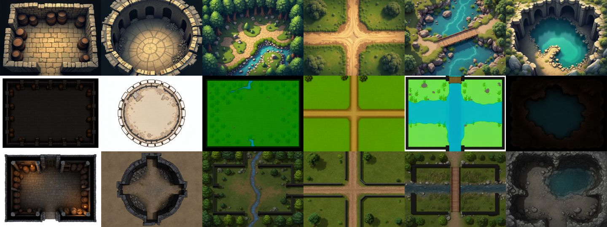
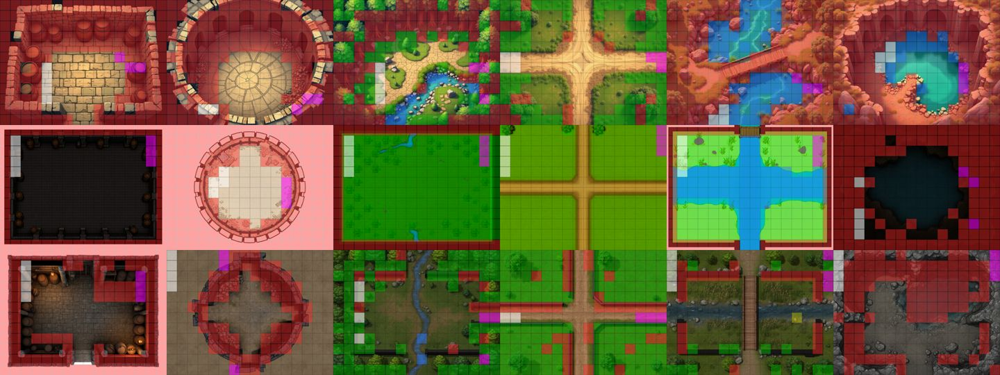
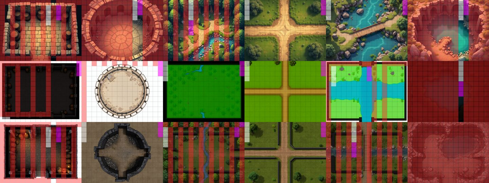

# Battlemap aus einem Bild – Versuch (C8), 15.11.2026

Frage: Kann ein lokales Bildmodell eine Draufsicht eines improvisierten Ortes malen, und lässt sich daraus ein
5e-Raster (Wand, Boden, Wasser, Baum, Fels) im Kartenformat der App (`presets/srd5/maps/*.json`) ablesen?

Werkzeug: `tools/battlemap_probe.py` (außerhalb der App; Pillow und numpy in `target/battlemap-venv`).
Rechner: RTX 5090 Laptop (24 GB), Modelle und Laufzeiten aus dem App-Datenordner.

## Bilder

Sechs Orte (Tavernenkeller, Wachturm-Ruine, Waldlichtung mit Bach, Wegkreuzung, Flussufer mit Brücke, Höhle),
gleicher Prompt („top-down orthographic battle map …, walls drawn as thick dark solid areas, no characters,
no text“), Seed 42, 1024×768.

| Modell | Zeit je Bild | Eindruck |
|---|---|---|
| Flux 1 dev Q5 | ~25 s | schönste Bilder, aber oft leicht schräg (Mauern mit Bögen und Seitenflächen), Wände hell |
| Qwen-Image 2.1 Q4 | ~32 s | flach und schematisch wie ein Spiel-Editor, teils leer (Lichtung) oder fast schwarz (Keller, Höhle) |
| Flux 2 dev Q4 | ~95 s | trifft den Battlemap-Stil am besten: echte Draufsicht, dicke dunkle Wände, Zäune, klare Räume |

## Raster ablesen

**Pixelverfahren** (Zellen 16×12, Farbe/Helligkeit/Textur je Zelle). Erste Fassung „dunkel = Wand“ scheiterte an
dunklen Böden und hellen Mauern. Zweite Fassung für Innenräume: Was die Bildmitte füllt, ist Boden; deutlich
anderes (3-Means auf Helligkeit, Sättigung, Wärme, Textur) ist Wand; Wasser nach Farbton. Außen: Grün dunkel =
Baum, grau strukturiert = Fels, braun = Weg.

Eigene Durchsicht der 18 Raster:

| Modell | gut | teils | falsch |
|---|---|---|---|
| Flux 2 | 5 | 1 (Höhle: Felskanten zu grob) | 0 |
| Qwen-Image | 6 (aber karge Karten) | 0 | 0 |
| Flux 1 | 3 | 2 (Lichtung, Höhle) | 1 (Flussufer als Innenraum gelesen) |

Selbsttest (die drei mitgelieferten Karten als verrauschte Bilder gezeichnet und zurückgelesen): 96–98 %
Übereinstimmung in Block/Wasser/frei – die Auswertung selbst ist also verlässlich, die Grenze sind die Bilder.
Einzelobjekte (Fässer, Kisten) werden nur erkannt, wenn sie an Wänden stehen (dann als Wand).

**Vision-Modell** (Qwen3-VL 8B über llama-server): unbrauchbar. Keines der 18 Raster hatte die verlangte Form
(12 Zeilen × 16 Zeichen); die Antworten sind Streifenmuster oder nur Boden, bei 8×6 ein Standard-Kasten statt des
kreuzförmigen Turms. Das Modell beschreibt Bilder gut, sieht aber keine Anordnung auf Rasterebene.

## Ergebnis und Empfehlung

- **Machbar mit Flux 2 und dem Pixelverfahren**: 5 von 6 Orten ergeben ein brauchbares, spielbares Raster samt
  passendem Hintergrundbild. Flux 1 ist schneller, aber die Schrägansicht stört; Qwen-Image liefert zuverlässige,
  aber langweilige Karten.
- **Grenzen**: ~95 s je Karte mit Flux 2 (auf einer RTX 5090), also nur als Vorbereitung im Hintergrund, nicht
  mitten im Kampf; nur für Nutzer mit installiertem Flux-Modell und genug Grafikspeicher. Einzelobjekte fehlen,
  Höhlen und Gelände mit vielen Felsen sind ungenau.
- **Vorschlag für einen Einbau** (Aufwand M): Erkennt der Spielleiter einen neuen Ort, erzeugt die App im
  Hintergrund ein Bild (Flux 2, sonst Flux 1), liest das Raster (Klassifikator nach Rust portiert), prüft es mit den
  Regeln aus `score` (begehbar 35–95 %, zusammenhängend, Gruppe und Gegner erreichbar) und nimmt sonst wie heute eine
  mitgelieferte Karte. Das Bild wird Hintergrund des Spielbretts. Der Spieler kann die Karte vor dem Kampf ansehen
  und verwerfen.
- **Nicht weiterverfolgen**: Raster direkt vom Vision-Modell (8B).
