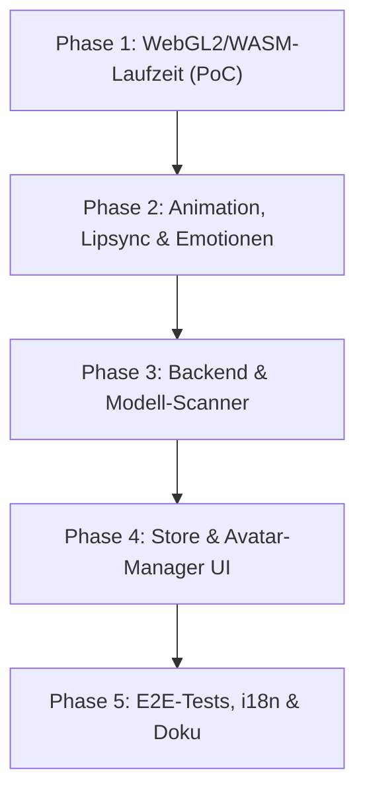

# 🗺️ OtakuSoul – Inochi2D / Inox2D Integrations-Roadmap

> **Ziel:** Vollständige Unterstützung für das quelloffene 2D-Puppenformat **Inochi2D** (`.inp`) als freie (FOSS) Alternative zu proprietärem Live2D Cubism, nahtlos integriert neben VRM, glTF, MMD und 2D-Porträts.

---

## 📌 Kontext & Motivation

* **Frei & Open Source (FOSS):** Im Gegensatz zu Live2D (proprietärer Cubism Core mit restriktiver EULA) ist Inochi2D zu 100 % freie Software (BSD 2-Clause). Es passt perfekt zur FOSS-Philosophie von OtakuSoul.
* **Rust-Synergie:** Mit **Inox2D** (`Inochi2D/inox2d`) existiert eine offizielle native Rust-Reimplementierung, die sich sowohl im Rust-Backend (`src-tauri`) als auch via WebAssembly (`wasm32-unknown-unknown`) im Webview-Frontend nutzen lässt.
* **Format:** Modelle liegen als kompaktes Einzelarchiv (`.inp`) vor, das Texturen, Mesh-Deformationen und Rigging-Parameter bündelt.

---

## 🧭 Phasenübersicht

---

## 🚀 Phase 1: WebGL2 / WASM Laufzeit & Viewer-PoC (Frontend)

Ziel ist ein isolierter Viewer, der eine `.inp`-Datei stabil im Tauri-Webview rendert.

- [ ] **CSP-Anpassung in `src-tauri/tauri.conf.json`:**
  - `script-src` um `'wasm-unsafe-eval'` ergänzen, damit WebAssembly-Instanziierung im Webview nicht blockiert wird.
- [ ] **Evaluierung der Web-Laufzeit:**
  - Option A: npm-Paket `inochi-avatar` (fertiges WebGL2/WASM-Paket auf Basis von Inox2D).
  - Option B: Eigener WASM-Build direkt aus dem Crate `inox2d` via `wasm-bindgen`.
- [ ] **Erstellung der Viewer-Komponente `src/components/avatar/Inochi2dViewer.tsx`:**
  - WebGL2-Canvas mit automatischem Resize-Observer.
  - Lifecycle: Sauberes Initialisieren, Pausieren bei unsichtbarem Tab und Freigeben der GPU-Ressourcen beim Unmount.
  - Snapshot-Unterstützung für Thumbnails (`answerSnapshots`, WebGL `preserveDrawingBuffer` oder Offscreen-Canvas).
- [ ] **Beispielmodell einbinden:**
  - Offenes FOSS-Testmodell (z. B. Aka / Eki / FOSS-Sample) unter `assets/inochi2d/` hinterlegen.
  - Pfad-Auflösung über Tauri-Asset-Protokoll (`asset://` bzw. `convertFileSrc`) oder als binärer `ArrayBuffer`.

---

## 🎭 Phase 2: Puppen-Steuerung (Lipsync, Blick & Emotionen)

Ziel ist es, der Inochi2D-Figur Leben einzuhauchen – analog zu VRM und Live2D.

- [ ] **Lippensynchronität (Lipsync):**
  - Anbindung an `audioPlayer.onAudioFrame` zur Abfrage der Lautstärkeamplitude in Echtzeit.
  - Ansteuerung der vertikalen Mundöffnung (Mapping auf Parameter wie `ParamMouthOpen` / `mouth_open`).
- [ ] **GoEmotions-Mapping (28 Stimmungen):**
  - Zuordnung der KI-Emotionsergebnisse (`currentEmotion.emotion`) zu Inochi2D-Parametern (z. B. Augenbrauen-Winkel, Augenform, Mund-Kurve).
  - Weiche Übergänge (Interpolation/Lerp) zwischen aufeinanderfolgenden Stimmungen, um Ruckler zu vermeiden.
- [ ] **Lebendige Ruhezustände (Idle Motion):**
  - Sanftes Atmen und leichtes Wiegen (angelehnt an `portraitMotion`).
  - Zufälliges, natürliches Blinzeln (`ParamEyeLOpen`, `ParamEyeROpen`).
- [ ] **Blickverfolgung (Optional):**
  - Sanfte Ausrichtung des Kopfes / der Augen bei Mauszeiger-Bewegung über dem Viewport.

---

## 🦀 Phase 3: Backend & Modell-Scanner (`src-tauri`)

Ziel ist die Erkennung, Validierung und Verwaltung lokaler `.inp`-Dateien.

- [ ] **Neues Backend-Modul `src-tauri/src/modules/inochi2d.rs`:**
  - Datenstruktur `ScannedInochi2d` (`id`, `name`, `model_path`, `preview_image`, `removable`).
  - Parsing von `.inp`-Dateien (Metadaten wie Puppen-Name, Autor, Version sowie Extrahieren des eingebetteten Vorschaubilds).
  - Einbindung der Rust-Crate `inox2d` oder Container-Inspektion (ZIP/Payload).
- [ ] **Suchpfade & Dateiverwaltung:**
  - Benutzerverzeichnis: `<Daten>/inochi2d/` (mitgeliefert / importiert).
  - Standard-Suchpfad in `paths::base_dirs()` registrieren.
- [ ] **Tauri IPC-Befehle (`commands/avatar.rs` & `lib.rs`):**
  - `scan_inochi2d_models() -> Vec<ScannedInochi2d>`
  - `import_inochi2d_model(source_path: String) -> Result<ScannedInochi2d, String>`
  - Anbindung an das bestehende `rename_avatar` und `delete_avatar` (Verschieben nach `.trash/avatars/`).
- [ ] **Typen synchronisieren:**
  - Export von `ScannedInochi2d` via `ts-rs` nach `src/types/generated/ScannedInochi2d.ts`.

---

## 🖥️ Phase 4: Store, UI & Avatar-Manager

Ziel ist die nahtlose Auswahl im Chat und in der Charakter-Konfiguration.

- [ ] **Zustandsverwaltung (`avatarSlice.ts`):**
  - Erweiterung des `avatar_mode`-Feldes: `'3d' | 'live2d' | 'inochi2d' | '2d'`.
  - Listenfeld `scannedInochi2ds` und Auswahl `activeInochi2dPath` im AppStore.
- [ ] **AvatarCanvas (`AvatarCanvas.tsx`):**
  - Umschalter in der Kopfleiste um Inochi2D erweitern (oder Zusammenfassung unter einem 2D-Puppen-Menü).
  - Lazy Loading des `Inochi2dViewer` analog zu `Live2DViewer`.
- [ ] **Avatar-Bibliothek (`AvatarManagerView.tsx`):**
  - Eigener Reiter oder Filter-Chip „Inochi2D“.
  - Import-Dialog für `.inp`-Dateien (Drag & Drop + Dateiauswahl).
  - Vorschau-Karten mit Rename-, Lösch- und Zuweisungs-Funktion.
- [ ] **Charakter-Verknüpfung:**
  - Unterstützung für `extensions.custom_inochi2d` in Charakterkarten (V2-PNG/JSON).

---

## 🌐 Phase 5: Lokalisierung, Tests & Dokumentation

- [ ] **Lokalisierung (i18n):**
  - Neue Schlüssel in `presets/locales/ui/de.json` (als Typquelle) sowie `en.json`, `ru.json`, `ja.json`.
  - Prüfung mit `npm run i18n:check`.
- [ ] **Automatisierte Tests:**
  - Unit-Tests: `src/test/avatarManager.test.ts` um Inochi2D-Zuweisung und Matching erweitern.
  - Typ-Sicherheits-Check via `src/types/wireCheck.ts`.
  - E2E-Test: Laden und Umschalten des Inochi2D-Avatars in der Chatansicht.
- [ ] **Dokumentation:**
  - Eintrag in `README.de.md` und `README.md` unter Avatare & Lizenzen.
  - Ergänzung in `ARCHITECTURE_INDEX.md` und thematischen Abschnitten in `AI.md`.
